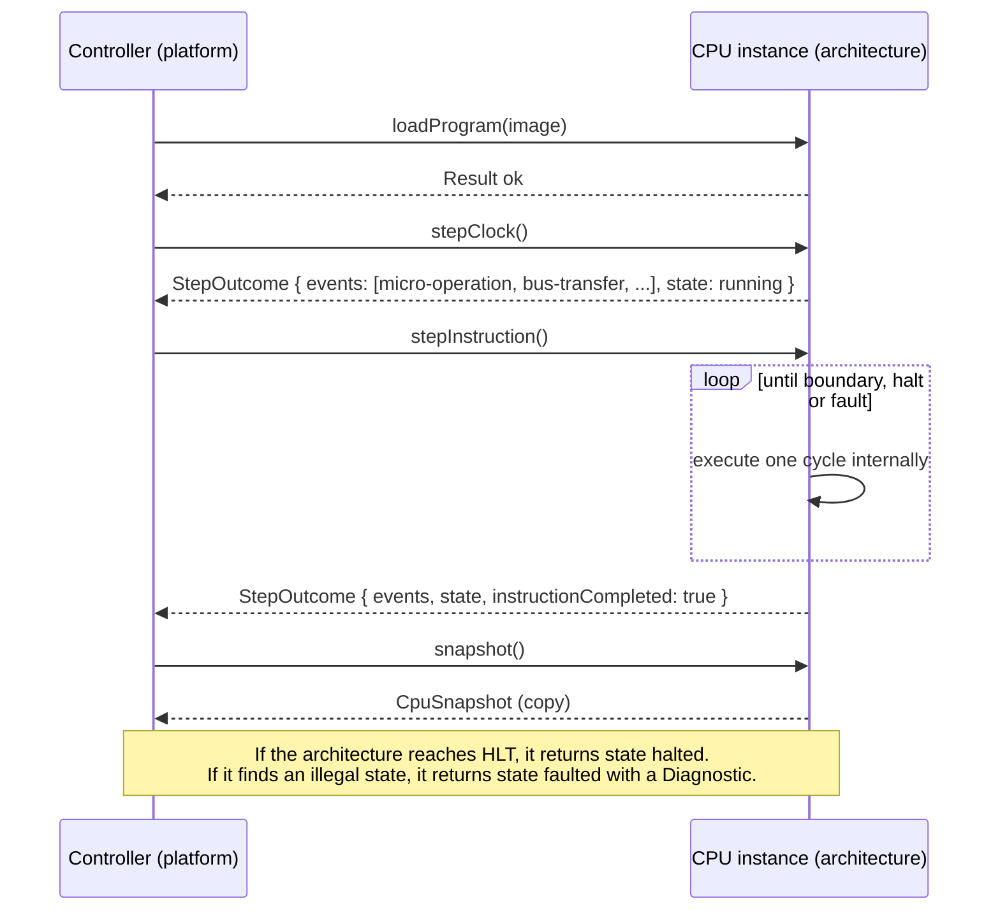

# BITSHIFT — CPU Architecture Strategy

**Status:** Proposed (Stage 0.2). The principle that each architecture owns its semantics is **[A]** (A-10). The contract and registration design is **[B]**. Open items are in section 9 and [DECISION_REGISTER.md](../decisions/DECISION_REGISTER.md).
**Related:** [SIMULATION_PLATFORM.md](SIMULATION_PLATFORM.md), [SYSTEM_ARCHITECTURE.md](SYSTEM_ARCHITECTURE.md), [ADR-001](../decisions/ADR-001-modular-simulation-platform.md), [BITSHIFT-8_ISA.md](../specifications/BITSHIFT-8_ISA.md)

---

## 1. Principle

Each CPU is a self-contained architecture package. The platform standardises how the application drives a CPU. It does not force CPUs to share registers, flags, word sizes, instruction formats or micro-operation sets.

This makes BITSHIFT-16 and RISC-V RV32I (v3.0) possible without changing the platform. See [ADR-001](../decisions/ADR-001-modular-simulation-platform.md).

## 2. What Is Shared and What Is Per Architecture

| Concern                                                                         | Shared (platform) | Per architecture                                                             |
| ------------------------------------------------------------------------------- | ----------------- | ---------------------------------------------------------------------------- |
| Lifecycle, run state, step and batch control                                    | Yes               | —                                                                            |
| Clock cycle counter and history                                                 | Yes               | —                                                                            |
| Breakpoints (address set and check)                                             | Yes               | Supplies the program counter value                                           |
| Event envelope (cycle, sequence, kind, payload)                                 | Yes               | Event kinds and payload types                                                |
| Snapshot envelope (ID, cycle, state, PC, register list, flag list, memory copy) | Yes               | Register names, widths, flag names, extra typed details                      |
| Program image container (origin, bytes, source map)                             | Yes               | Byte encoding rules                                                          |
| Register set and roles                                                          | —                 | Yes                                                                          |
| Flags and their rules                                                           | —                 | Yes                                                                          |
| Word and address width, memory size and layout                                  | —                 | Yes                                                                          |
| ALU operations                                                                  | —                 | Yes                                                                          |
| Instruction set, encoding and decoding                                          | —                 | Yes (through an ISA descriptor)                                              |
| Micro-operation sequences                                                       | —                 | Yes (within the shared event envelope, DR-013)                               |
| What one "step" means internally                                                | —                 | Yes, within the rule that one clock cycle holds one micro-operation (DR-053) |
| Instruction explanations (MVP-022)                                              | —                 | Yes (DR-061)                                                                 |
| Visualization adapter                                                           | —                 | Yes                                                                          |

## 3. The Three Execution Levels

The brief requires these to be treated as distinct. Each level has a different owner and a different contract method.

| Level               | What it is                                     | Owner of the rule                                                 | Contract operation      | Returned to platform                                                   |
| ------------------- | ---------------------------------------------- | ----------------------------------------------------------------- | ----------------------- | ---------------------------------------------------------------------- |
| **Micro-operation** | One atomic transfer or ALU action              | Architecture                                                      | Internal to `stepClock` | Events describing it                                                   |
| **Clock cycle**     | One micro-operation under DR-053               | Architecture (one per cycle); platform counts                     | `stepClock()`           | `StepOutcome` for that cycle                                           |
| **Instruction**     | All cycles until the next instruction boundary | Architecture decides boundaries; platform decides how many to run | `stepInstruction()`     | `StepOutcome` covering several cycles, with `instructionCompleted` set |

Rules:

- The platform never looks inside an instruction. It only asks for cycles or instruction boundaries.
- An architecture implements `stepInstruction` in terms of its own cycles. It must not skip micro-operation events when it does so.
- A clock step at an instruction boundary starts the next instruction. This is consistent with "instruction step ends at a boundary".

## 4. Platform and CPU Contract (conceptual)

This section describes the operations and their meaning. The exact TypeScript interfaces are in [MODULE_CONTRACTS.md](../contracts/MODULE_CONTRACTS.md). Section 4.3 lists the changes that document needs.

### 4.1 Operations

| Operation                    | Purpose                                                               | Failure behaviour                                                                                                        |
| ---------------------------- | --------------------------------------------------------------------- | ------------------------------------------------------------------------------------------------------------------------ |
| `createInstance()`           | Fresh CPU in post-reset state                                         | Cannot fail                                                                                                              |
| `loadProgram(image)`         | Writes the program bytes at the origin and sets the entry PC          | `Result` error if the image does not fit, the origin is invalid, or the architecture ID does not match. State unchanged. |
| `reset()`                    | Restores post-load state (registers, flags, PC, memory as loaded)     | Cannot fail                                                                                                              |
| `stepClock()`                | Executes one clock cycle                                              | Illegal state → fault outcome                                                                                            |
| `stepInstruction()`          | Executes cycles to the next instruction boundary, or to halt or fault | As above                                                                                                                 |
| `snapshot()`                 | Returns an immutable copy of the current state                        | Cannot fail                                                                                                              |
| `readMemory(range)`          | Returns a copy of part of memory for inspectors                       | `Result` error for out-of-range requests                                                                                 |
| `explainInstruction(record)` | Returns a one-line explanation of a completed instruction (DR-061)    | Pure. Returns a generic text if the record is unknown.                                                                   |

Events come back inside each step's `StepOutcome`. The architecture does not keep them.

### 4.2 Interaction Sequence



### 4.3 Contract Changes Needed (DR-066)

These changes follow from the architecture decisions in this stage. They are not applied to the contract documents yet.

| Document                                  | Change                                                                                                                                                   |
| ----------------------------------------- | -------------------------------------------------------------------------------------------------------------------------------------------------------- |
| MODULE_CONTRACTS §3 (ExecutionController) | Replace "run loop owned by the controller" with `beginRun`, `runBatch(n)` and `endRun`. The UI owns timing (DR-058).                                     |
| MODULE_CONTRACTS §2 (CpuInstance)         | Add `explainInstruction`. Rename `stepMicroOperation` to `stepClock` to match the product terms (MVP-013).                                               |
| MODULE_CONTRACTS §1 (CpuArchitecture)     | Add the explanation hook. Registry is supplied at wiring time, not imported by the platform (DR-057).                                                    |
| EVENT_MODEL §2 and §3                     | Add `controlSignals` to micro-operation payloads (DR-053, MVP-019). Require before and after values on state-changing events (SIMULATION_PLATFORM §7.2). |
| DATA_CONTRACTS §3                         | Note that `CpuSnapshot.tick` counts clock cycles (SIMULATION_PLATFORM §2.1).                                                                             |

## 5. Registration and the Composition Root

### 5.1 Decision (DR-057, proposed)

Architectures are registered in the **composition root**: a single module in `src/app/` that imports each architecture's public entry and passes the list to the platform as data.

```ts
// src/app/bootstrap.ts — illustrative only, not implemented
import { bitshift8 } from '../architectures/bitshift-8';   // public entry only
import { createController } from '../platform';

export const controller = createController({
  architectures: [bitshift8],       // future: bitshift16, riscv32i
  assemblerFor: (id) => /* selects ISA descriptor by id */,
});
```

The platform's `registry` module defines the entry type and the lookup function. It imports no architecture.

### 5.2 Why Here and Not in the Platform

The earlier draft placed a list of descriptors in `src/platform/registry.ts`. That made the platform import BITSHIFT-8, which breaks the rule that the platform knows no CPU. The composition root is the only place that knows which CPUs exist.

### 5.3 Alternatives Considered

| Option                                          | Verdict                                                                      |
| ----------------------------------------------- | ---------------------------------------------------------------------------- |
| Composition root supplies a list (chosen)       | Platform stays generic; one place to add a CPU; testable with a fixture list |
| Platform imports a static list of architectures | Rejected: violates DEP-01                                                    |
| Automatic discovery from the file system        | Rejected: hides dependencies; complicates the build                          |
| Dynamic plugins loaded at run time              | Rejected: needs a plugin API and security review; not justified for v1.0     |
| Dependency-injection container                  | Rejected: more machinery than a list needs                                   |

### 5.4 Adding an Architecture (future)

1. Add `src/architectures/<id>/` with the usual layout.
2. Add one entry to the composition-root list.
3. Add tests in `tests/architectures/<id>/`.
4. No platform, assembler or visualization change should be needed. If one is, the design has failed and an ADR is required.

## 6. Architecture Descriptor

The descriptor is the only thing the rest of the application reads at startup. It contains data, not behaviour. The full type is in [DATA_CONTRACTS.md](../contracts/DATA_CONTRACTS.md).

| Field                                    | Purpose                                                       |
| ---------------------------------------- | ------------------------------------------------------------- |
| `id`                                     | Stable identifier, lowercase kebab-case, e.g. `bitshift-8`    |
| `displayName`                            | Human name, e.g. `BITSHIFT-8`                                 |
| `wordBits`, `addressBits`, `memoryBytes` | Sizes (BITSHIFT-8: 8, 8, 256)                                 |
| `registers`                              | Generic list: name, width, role, programmer-visible           |
| `flags`                                  | Generic list: name and meaning                                |
| `programCounter`                         | Name of the register that is the PC, or `none` (DR-022)       |
| `isa`                                    | Instruction descriptor for the assembler and decoder (DR-015) |
| `createInstance()`                       | Factory                                                       |

The descriptor does not include the explanation function or the visualization adapter. Those are supplied alongside it in the architecture's public entry, so the platform never sees them.

## 7. Coupling With Other Subsystems

| Subsystem                                       | Coupling                                            | Rule                                                                                                            |
| ----------------------------------------------- | --------------------------------------------------- | --------------------------------------------------------------------------------------------------------------- |
| Assembler (D)                                   | Receives the ISA descriptor as an argument          | The assembler never imports an architecture (DEP-03). Mnemonics, opcodes and lengths come from the descriptor.  |
| Visualization (E)                               | Receives the architecture's adapter as a value      | Adapter maps snapshot and events to a view model. Visualization never imports an architecture (DEP-04, DR-062). |
| Timeline and explanations (F, MVP-021, MVP-022) | Explanation function from the architecture (DR-061) | Pure function of an instruction record. The UI displays its text and never builds it.                           |
| Breakpoints (B)                                 | Needs the PC value from the snapshot                | Works for any architecture with a PC. Without one, breakpoints are disabled (DR-022).                           |

## 8. Extensibility

### 8.1 What Varies Across CPUs and How It Is Accommodated

| Variation                                            | Mechanism                                                  | Limit in v1.0 design                                                                                                   |
| ---------------------------------------------------- | ---------------------------------------------------------- | ---------------------------------------------------------------------------------------------------------------------- |
| Register layout (count, width, roles)                | Generic register list in the descriptor                    | None known. Phase 1 fixture uses different widths.                                                                     |
| Flags                                                | Generic flag list                                          | Flags are one bit each. A CPU with multi-bit status fields would need a new type; that would be an ADR.                |
| Instruction set and encoding                         | ISA descriptor plus architecture decoder                   | Assembler syntax rules (DR-019, DR-020) may need per-architecture options.                                             |
| Memory model (size, unified or split, address width) | Descriptor fields and the architecture's memory            | A split memory would need a second memory view in the snapshot. Deferred.                                              |
| Execution model                                      | Architecture decides what a cycle contains (within DR-053) | A pipelined CPU overlaps instructions in one cycle. This does not fit the one-micro-operation-per-cycle rule. See 8.2. |
| Visualization                                        | Per-architecture adapter and SVG layout                    | A new datapath needs a new SVG layout and adapter. The shared components do not change.                                |
| Explanations                                         | Per-architecture function                                  | None known.                                                                                                            |

### 8.2 Known Limit: Pipelined and Multi-Issue CPUs

The v1.0 step model assumes each cycle contains one micro-operation. A pipelined CPU would overlap several instructions in one cycle, and a wider CPU could run several micro-operations in parallel. Neither fits the rule in SIMULATION_PLATFORM §2.1.

Mitigation for later releases:

- The rule is written as a v1.0 decision (DR-053), not as a fixed platform law.
- A future architecture would declare its step model in the descriptor (for example `cyclesPerStep: 'one-micro-operation' | 'many-micro-operations'`). This is a later extension, and it is not built now.
- Pipeline visualization is a v2.0 feature (EX-06). Designing for it now would be speculative.

### 8.3 What We Do Not Build

- A generic CPU model that covers every possible CPU (rejected in ADR-001).
- A plugin system with runtime loading (rejected in section 5.3).
- Declarative micro-operation languages. The first version uses typed code (DR-013).
- Any BITSHIFT-16 or RISC-V support, even as stubs (EX-11, EX-12).

## 9. Open Questions Affecting This Strategy

| Question                                                  | Register       | Effect if unresolved                                                                        |
| --------------------------------------------------------- | -------------- | ------------------------------------------------------------------------------------------- |
| ISA descriptor data-only or includes functions            | DR-015         | Descriptor type shape in Phase 1                                                            |
| Micro-operation representation and visibility             | DR-013         | Event payload shape; control signal display (MVP-019)                                       |
| Architecture-defined event kinds                          | DR-014         | Whether custom kinds are allowed; shared visualization must ignore unknown kinds either way |
| Clock cycles per instruction and micro-operation sequence | DR-011         | Blocks clock-level stepping (MVP-013) and the timeline's cycle numbers                      |
| Stepping boundaries                                       | DR-018         | Whether an instruction step can end mid-instruction                                         |
| PC required in every architecture                         | DR-022         | Breakpoints for PC-less architectures                                                       |
| Explanation text for each instruction                     | DR-045, DR-061 | Whether MVP-022 is in v1.0                                                                  |
| Contract changes listed in §4.3                           | DR-066         | Contract documents disagree with this strategy until applied                                |

## 10. Testing per Architecture

- Each architecture has a conformance suite in `tests/architectures/<id>/`. Its expected values come from the ISA specification, not from the implementation.
- The platform is tested with a **test-only fixture architecture** in `tests/platform/fixtures/`. It uses different register widths, a different flag set and a short fixed script of micro-operations. It proves that nothing in the platform depends on BITSHIFT-8. It is never shipped.
- The fixture is also used to test the composition-root wiring with two architectures in the list. This tests lookup and selection without any second real CPU.

## 11. Anti-Patterns (rejected)

- A shared "universal register file" every architecture must fit into.
- Platform code that branches on `architectureId`. Differences must come from descriptor data or the adapter.
- An architecture importing another architecture's internals.
- Visualization reading CPU internals instead of snapshots and events.
- Building v2 or v3 CPUs "to be ready". Build the contracts and stop.
- Putting the architecture list inside the platform (corrected in this stage, section 5.2).
- Explanation text written in the UI. It must come from the architecture.
