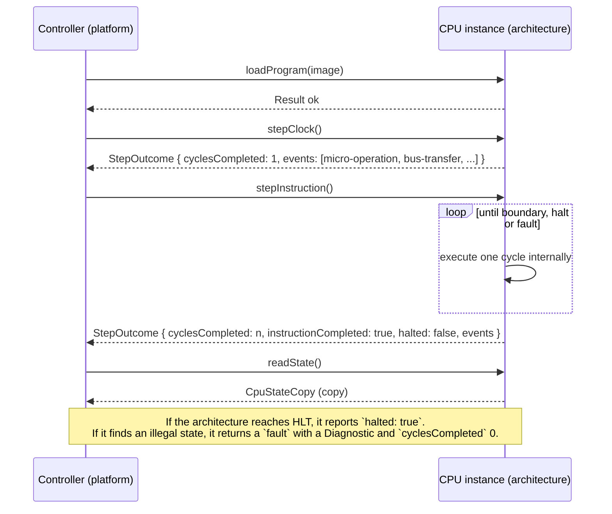

# BITSHIFT — CPU Architecture Strategy

**Status:** Stage 0.3, aligned with the approved contracts (DR-066 as amended, DR-067). The principle that each architecture owns its semantics is **[A]** (A-10). The registration, step and explanation decisions are **Approved** in [DECISION_REGISTER.md](../decisions/DECISION_REGISTER.md) (DR-053, DR-057, DR-058, DR-061). Section 4.4 records the approval status of each contract change, and section 4.5 records the Stage 0.3 resolutions. The contract documents implement the approved list.
**Related:** [SIMULATION_PLATFORM.md](SIMULATION_PLATFORM.md), [SYSTEM_ARCHITECTURE.md](SYSTEM_ARCHITECTURE.md), [ADR-001](../decisions/ADR-001-modular-simulation-platform.md), [BITSHIFT-8_ISA.md](../specifications/BITSHIFT-8_ISA.md)

---

## 1. Principle

Each CPU is a self-contained architecture package. The platform standardises how the application drives a CPU. It does not force CPUs to share registers, flags, word sizes, instruction formats or micro-operation sets.

This makes BITSHIFT-16 and RISC-V RV32I (v3.0) possible without changing the platform. See [ADR-001](../decisions/ADR-001-modular-simulation-platform.md).

## 2. What Is Shared and What Is Per Architecture

| Concern                                                                         | Shared (platform) | Per architecture                                                                                                                                            |
| ------------------------------------------------------------------------------- | ----------------- | ----------------------------------------------------------------------------------------------------------------------------------------------------------- |
| Lifecycle, run state, step and batch control                                    | Yes               | —                                                                                                                                                           |
| Authoritative cycle counter (DR-067) and history                                | Yes               | —                                                                                                                                                           |
| Breakpoints (address set and check)                                             | Yes               | Supplies the program counter value                                                                                                                          |
| Event envelope (cycle, sequence, kind, payload)                                 | Yes               | Event kinds and payload types                                                                                                                               |
| Snapshot envelope (ID, cycle, state, PC, register list, flag list, memory copy) | Yes               | Register names, widths, flag names, extra typed details                                                                                                     |
| Program image container (origin, bytes, source map)                             | Yes               | Byte encoding rules                                                                                                                                         |
| Register set and roles                                                          | —                 | Yes                                                                                                                                                         |
| Flags and their rules                                                           | —                 | Yes                                                                                                                                                         |
| Word and address width, memory size and layout                                  | —                 | Yes                                                                                                                                                         |
| ALU operations                                                                  | —                 | Yes                                                                                                                                                         |
| Instruction set, encoding and decoding                                          | —                 | Yes (through an ISA descriptor)                                                                                                                             |
| Micro-operation sequences                                                       | —                 | Yes (within the shared event envelope; representation per DR-013)                                                                                           |
| What one step means internally                                                  | —                 | Yes. For BITSHIFT-8, one clock cycle holds one micro-operation (DR-053, approved with qualification). Other architectures declare their own step semantics. |
| Instruction explanations (MVP-022)                                              | —                 | Yes, optional descriptive metadata (DR-061, approved with qualification)                                                                                    |
| Visualization adapter                                                           | —                 | Yes, supplied to the view layer as a value (DR-062, approved)                                                                                               |

## 3. The Three Execution Levels

The brief requires these to be treated as distinct. Each level has a different owner and a different contract method.

| Level               | What it is                                                               | Owner of the rule                                                                                            | Contract operation      | Returned to platform                                                   |
| ------------------- | ------------------------------------------------------------------------ | ------------------------------------------------------------------------------------------------------------ | ----------------------- | ---------------------------------------------------------------------- |
| **Micro-operation** | One atomic transfer or ALU action                                        | Architecture                                                                                                 | Internal to `stepClock` | Events describing it                                                   |
| **Clock cycle**     | The unit of simulated time. For BITSHIFT-8, one micro-operation (DR-053) | Architecture decides what a cycle contains and reports `cyclesCompleted`; platform owns the counter (DR-067) | `stepClock()`           | `StepOutcome` for that cycle                                           |
| **Instruction**     | All cycles until the next instruction boundary                           | Architecture decides boundaries; platform decides how many to run                                            | `stepInstruction()`     | `StepOutcome` covering several cycles, with `instructionCompleted` set |

Rules:

- The platform never looks inside an instruction. It only asks for cycles or instruction boundaries.
- The platform does not check how many micro-operations a cycle contains. That is an architecture rule (DR-053 qualification).
- The architecture reports `cyclesCompleted`, the work done in a step. It never reports a cycle number. The platform owns the only counter (DR-067).
- An architecture implements `stepInstruction` in terms of its own cycles. It must not skip micro-operation events when it does so.
- A clock step at an instruction boundary starts the next instruction. This is consistent with "instruction step ends at a boundary".

## 4. Platform and CPU Contract (conceptual)

This section describes the operations and their meaning. The exact TypeScript interfaces are in [MODULE_CONTRACTS.md](../contracts/MODULE_CONTRACTS.md). Section 4.3 lists the changes that Stage 0.3 must apply.

### 4.1 Operations

| Operation            | Purpose                                                                                                  | Failure behaviour                                                                                                        |
| -------------------- | -------------------------------------------------------------------------------------------------------- | ------------------------------------------------------------------------------------------------------------------------ |
| `createInstance()`   | Fresh CPU in post-reset state. Lives on the architecture, not in the data descriptor (SC-15).            | Cannot fail                                                                                                              |
| `loadProgram(image)` | Writes the program bytes at the origin and sets the entry PC                                             | `Result` error if the image does not fit, the origin is invalid, or the architecture ID does not match. State unchanged. |
| `reset()`            | Restores post-load state (registers, flags, PC, memory as loaded)                                        | Cannot fail                                                                                                              |
| `stepClock()`        | Executes one clock cycle                                                                                 | Illegal state → fault outcome                                                                                            |
| `stepInstruction()`  | Executes cycles to the next instruction boundary, or to halt or fault                                    | As above                                                                                                                 |
| `readState()`        | Returns an architecture state copy that shares no mutable object with the instance (DATA_CONTRACTS §4.1) | Cannot fail                                                                                                              |
| `readMemory(range)`  | Returns a copy of part of memory for inspectors                                                          | `Result` error for out-of-range requests                                                                                 |

Events come back inside each step's `StepOutcome`. The architecture does not keep them. `StepOutcome` carries no breakpoint information: breakpoints belong to the platform (SC-10, amended).

The explanation function is **not** an instance operation. It is an optional, pure function on the architecture (`explainInstruction(record)`, DR-061, SC-11). It is never called on the execution path.

### 4.2 Interaction Sequence



### 4.3 Reconciled Contract Changes for Stage 0.3

These are the changes that the contract documents need so that they agree with the approved architecture decisions. They are **not applied** in this stage. They were approved on 2026-11-16 as amended. Section 4.4 records the status of each item and supersedes the default wording in 4.3 where they differ.

Each change names the contract document, the current text, the required text, and the source of the requirement. Changes marked **Decision** need a product-owner answer, and Stage 0.3 can proceed on the stated default if no answer comes.

#### 4.3.1 Controller and run loop

| ID    | Document and location | Current contract                                                                                   | Required change                                                                                                                                                                                                        | Source                           |
| ----- | --------------------- | -------------------------------------------------------------------------------------------------- | ---------------------------------------------------------------------------------------------------------------------------------------------------------------------------------------------------------------------- | -------------------------------- |
| SC-01 | MODULE_CONTRACTS §3   | `run()` and `pause()`; "the controller's own loop" runs batches                                    | Replace with `beginRun()`, `runBatch(n)` and `endRun()`. The controller has no loop and no timer. The UI calls `runBatch`. `runBatch(n)` executes up to n clock cycles (SC-01, amended in §4.4).                       | DR-058; SIMULATION_PLATFORM §3–4 |
| SC-02 | MODULE_CONTRACTS §3   | "Methods are fire-and-forget. Results appear through `subscribe`."                                 | Methods are synchronous and return `Result` where they can fail. Results are also delivered through `subscribe`. The two statements conflict; the synchronous form is the approved one.                                | SIMULATION_PLATFORM §4           |
| SC-03 | MODULE_CONTRACTS §3   | `stepMicroOperation()`                                                                             | Rename to `stepClock()`.                                                                                                                                                                                               | DR-053; MVP-013                  |
| SC-04 | MODULE_CONTRACTS §3   | `ControllerUpdate.reason` includes `'run-batch'` and no run-state reasons                          | Add `'run-start'`, `'run-end'`, `'clock-step'` and `'instruction-step'`. Keep the others.                                                                                                                              | SIMULATION_PLATFORM §3           |
| SC-05 | MODULE_CONTRACTS §3   | `selectArchitecture(id)`                                                                           | **Decision:** v1.0 has one architecture, and the composition root supplies the list. Either remove `selectArchitecture` or keep it as a lookup among supplied entries. **Default if unanswered:** remove it from v1.0. | DR-057; DR-059                   |
| SC-06 | MODULE_CONTRACTS §3   | `setBreakpoints(addresses): void`                                                                  | Return `Result`, because an out-of-range address is an error.                                                                                                                                                          | SIMULATION_PLATFORM §9           |
| SC-07 | MODULE_CONTRACTS §3   | Controller has no options. The assembler is listed as a contract, but its wiring is not described. | Controller is created by a factory that receives `architectures` and `historyLimit`. The assembler is wired by the composition root and is not a controller dependency.                                                | DR-057; DR-060; DR-056           |
| SC-08 | MODULE_CONTRACTS §3   | `snapshot` property on the controller                                                              | Define as a read-only copy returned by a method, or as a getter that returns a copy. A property that appears mutable must not be used.                                                                                 | SIMULATION_PLATFORM §7.5         |

#### 4.3.2 CPU instance and architecture

| ID    | Document and location                     | Current contract                                                                      | Required change                                                                                                                                                                                    | Source                                         |
| ----- | ----------------------------------------- | ------------------------------------------------------------------------------------- | -------------------------------------------------------------------------------------------------------------------------------------------------------------------------------------------------- | ---------------------------------------------- |
| SC-09 | MODULE_CONTRACTS §2                       | `stepMicroOperation()` on `CpuInstance`                                               | Rename to `stepClock()` (see SC-03).                                                                                                                                                               | DR-053                                         |
| SC-10 | MODULE_CONTRACTS §2                       | `StepOutcome { events, state, instructionCompleted }`                                 | Add `cyclesCompleted: number` (a delta; the platform owns the cycle counter, DR-067). `breakpointAtPc` is removed: breakpoints are platform-owned (amended, §4.4).                                 | SIMULATION_PLATFORM §6                         |
| SC-11 | CPU strategy §4.1 and MODULE_CONTRACTS §2 | `explainInstruction` listed among instance operations                                 | Place `explainInstruction` on the architecture, not the instance. It is pure and takes an instruction record. It is optional.                                                                      | DR-061                                         |
| SC-12 | MODULE_CONTRACTS §2                       | `snapshot()` "must return a copy"                                                     | Make the rule normative: no snapshot shares an array, object or byte buffer with the instance. Memory bytes are copied with a new array.                                                           | SIMULATION_PLATFORM §7.5; DR-056 requirement 4 |
| SC-13 | DATA_CONTRACTS §2 and MODULE_CONTRACTS §1 | `createInstance()` appears on **both** `ArchitectureDescriptor` and `CpuArchitecture` | **Decision:** DR-015 (descriptor data-only or includes functions). **Default if unanswered:** the descriptor is data-only (DR-015 proposal), and `createInstance` lives only on `CpuArchitecture`. | DR-015; CPU strategy §6                        |
| SC-14 | DATA_CONTRACTS §2                         | `ArchitectureDescriptor` has no `programCounter` field                                | Add `programCounter: string \| 'none'` (the register name, or `none` for PC-less architectures). Deferred pending DR-022 (SC-14, see §4.4).                                                        | DR-022 (proposed); CPU strategy §6             |
| SC-15 | MODULE_CONTRACTS §1                       | `CpuArchitecture { descriptor, createInstance, visualization }`                       | Add `explainInstruction?` (optional, DR-061). Keep `visualization` as a value supplied to the view layer (DR-062).                                                                                 | DR-061; DR-062                                 |
| SC-16 | Not in any contract                       | No type for the registry                                                              | Add `ArchitectureRegistry`: a readonly list of `CpuArchitecture` plus `lookup(id): Result`. It is defined in the platform, and the list is supplied by the composition root.                       | DR-057                                         |

#### 4.3.3 Events and history

| ID    | Document and location                                                      | Current contract                                                                              | Required change                                                                                                                                                                                                                                                                      | Source                                  |
| ----- | -------------------------------------------------------------------------- | --------------------------------------------------------------------------------------------- | ------------------------------------------------------------------------------------------------------------------------------------------------------------------------------------------------------------------------------------------------------------------------------------ | --------------------------------------- |
| SC-17 | DATA_CONTRACTS §1, EVENT_MODEL §2, MODULE_CONTRACTS, all architecture docs | Field and type called `tick` (`Tick`), while the approved terms are "clock cycle" and "cycle" | **Naming decision:** rename the field to `cycle` and the type to `ClockCycle`, and update every use. Document that the counter starts at 0 after reset and counts clock cycles. Until approved, the two terms mean the same thing; this is a naming conflict, not a behavioural one. | DR-053; SIMULATION_PLATFORM §2.1 rule 2 |
| SC-18 | EVENT_MODEL §3                                                             | `micro-operation` payload `{ label, sources, destinations }`                                  | Add `controlSignals: readonly string[]`. The names are supplied by the architecture, so the shared envelope does not constrain them.                                                                                                                                                 | DR-053; MVP-019; DR-013 finding R-02    |
| SC-19 | EVENT_MODEL §3                                                             | `flag-update` payload `{ flag, value }`; `output-emitted` payload `{ value }`                 | Add `before` and `after` to both, so every state change carries before and after values.                                                                                                                                                                                             | SIMULATION_PLATFORM §7.2 invariant      |
| SC-20 | EVENT_MODEL §2 and §5                                                      | Ordering rules                                                                                | Add the invariant: applying the events of a cycle to the previous snapshot yields the next snapshot.                                                                                                                                                                                 | SIMULATION_PLATFORM §7.2                |
| SC-21 | EVENT_MODEL §6                                                             | "Clock-level events are kept only for the most recent step"                                   | Change to "only for the latest instruction".                                                                                                                                                                                                                                         | DR-056                                  |
| SC-22 | EVENT_MODEL §7 `TimelineEntry`                                             | `startTick`, `endTick`, `summary` from `describeEvent`                                        | Rename to `startCycle` and `endCycle`. Replace `summary` with `changes` (before and after values) and optional `explanation` (DR-061).                                                                                                                                               | DR-056; DR-061                          |
| SC-23 | EVENT_MODEL §4                                                             | Architecture-specific kinds, "open decision (DR-014)"                                         | Keep the open status. Add a note that the platform forwards unknown kinds unchanged and shared visualization ignores them.                                                                                                                                                           | DR-014 (open); DR-043 (proposed)        |
| SC-24 | EVENT_MODEL §8                                                             | Example micro-operation events without control signals                                        | Update the example to include `controlSignals` and cycle naming.                                                                                                                                                                                                                     | SC-17, SC-18                            |

#### 4.3.4 Visualization, store and persistence

| ID    | Document and location | Current contract                                                        | Required change                                                                                                                                                                                                        | Source                           |
| ----- | --------------------- | ----------------------------------------------------------------------- | ---------------------------------------------------------------------------------------------------------------------------------------------------------------------------------------------------------------------- | -------------------------------- |
| SC-25 | MODULE_CONTRACTS §5   | `MemoryInspector.recentlyWritten()` and `recentlyRead()`                | Remove. These are stateful queries that the CPU instance contract does not support. Highlights come from memory events in the current cycle, which is consistent with the event model.                                 | SIMULATION_PLATFORM §7; DR-053   |
| SC-26 | MODULE_CONTRACTS §6   | `VisualizationAdapter.describeEvent(event)` used for timeline summaries | Remove from the timeline role. Timeline explanations come from the architecture's `explainInstruction` (DR-061). Keep `describeEvent` only if the event list needs labels, and mark it as such.                        | DR-061; DR-062                   |
| SC-27 | DATA_CONTRACTS §9     | `DatapathViewModel` has `activeOperation?: string` only                 | Add `activeControlSignals: readonly string[]` (MVP-019). Keep `activeOperation`.                                                                                                                                       | MVP-019; DR-062                  |
| SC-28 | MODULE_CONTRACTS §7   | "Store shape is decided in Phase 5 (DR-035)"                            | Replace with the approved store approach: React's `useSyncExternalStore` over the controller's `subscribe` (DR-054). The store keeps the current snapshot, the previous snapshot, the latest event batch and UI state. | DR-054; SIMULATION_PLATFORM §7.3 |
| SC-29 | Not in any contract   | No persistence contract                                                 | Add `EditorPersistence` in the application layer: `load(): Result<string>` and `save(text): Result`. Every access is wrapped in try and catch. The platform does not depend on it.                                     | DR-063                           |
| SC-30 | MODULE_CONTRACTS §4   | `assemble(source, isa, architectureId)`                                 | Keep the ISA argument (DR-060). Confirm whether `architectureId` is still needed, since `ProgramImage` carries it.                                                                                                     | DR-060                           |

#### 4.3.5 Naming and cross-document consistency

| ID    | Item                 | Required change                                                                                                                                                                                                                                                                                               |
| ----- | -------------------- | ------------------------------------------------------------------------------------------------------------------------------------------------------------------------------------------------------------------------------------------------------------------------------------------------------------- |
| SC-31 | Terms                | Use one term for each concept across all contract documents: _clock cycle_ (time unit), _micro-operation_ (one action), _instruction step_, _clock-level step_, _run batch_, _explanation_ (descriptive text), _view model_ (display data). Remove synonyms such as "micro-operation step" and "step result". |
| SC-32 | Operation names      | `stepClock`, `stepInstruction`, `beginRun`, `runBatch`, `endRun`, `explainInstruction`. Apply everywhere.                                                                                                                                                                                                     |
| SC-33 | Ownership statements | MODULE_CONTRACTS §8 must match SYSTEM_ARCHITECTURE §7 after SC-01 to SC-29 are applied.                                                                                                                                                                                                                       |

#### 4.3.6 Decisions needed before Stage 0.3 can finish

| ID    | Question                                                        | Default if unanswered                                                                                          | Blocks             |
| ----- | --------------------------------------------------------------- | -------------------------------------------------------------------------------------------------------------- | ------------------ |
| SC-D1 | Approve this reconciled list (DR-066).                          | None. Stage 0.3 does not apply changes without it.                                                             | All of section 4.3 |
| SC-D2 | DR-015: data-only descriptor, or descriptor with functions.     | Data-only; factory on `CpuArchitecture` (SC-13).                                                               | SC-13, SC-14       |
| SC-D3 | Runtime architecture selection in v1.0 (SC-05).                 | Not supported in v1.0.                                                                                         | SC-05              |
| SC-D4 | DR-014: whether architectures may define their own event kinds. | Yes, namespaced (DR-043), pending approval. Contract text is written to allow it and to work if it is refused. | SC-23 only         |
| SC-D5 | DR-045: whether explanations are in v1.0.                       | The optional fields in SC-11, SC-15 and SC-22 stay optional, so the contracts work either way.                 | SC-22 only         |

#### 4.3.7 What Stage 0.3 can do now and what it must wait for

- **Can be done now without further decisions:** SC-01 to SC-04, SC-06 to SC-12, SC-14 to SC-16, SC-18 to SC-22, SC-24 to SC-28, SC-30 to SC-33. These follow approved decisions directly (DR-053 to DR-063), and none depends on BITSHIFT-8 values, so the open ISA items do not block them.
- **Can be done with the defaults above:** SC-05, SC-13, SC-17 (rename `tick` to `cycle` as the default naming), SC-23 and SC-29.
- **Must wait for product owner approval:** SC-D1 (the list itself) and the decisions in SC-D2 to SC-D5 if the defaults are not accepted.
- **Must not be done in Stage 0.3:** any concrete micro-operation vocabulary or control-signal names, any cycle count, or any explanation template. Those belong to Phase 2 and depend on DR-011 and DR-013 (finding R-01, R-02).

#### 4.4 Approval status and amendments (2026-11-16)

The product owner approved DR-066 and SC-D1, subject to the amendments below. Unless stated, each item in 4.3 is approved as written. This section supersedes the default wording in 4.3 where they differ.

| ID             | Status                      | Approved text, amendment or deferral                                                                                                                                                                                                                                                                                                                                                                                                                                      |
| -------------- | --------------------------- | ------------------------------------------------------------------------------------------------------------------------------------------------------------------------------------------------------------------------------------------------------------------------------------------------------------------------------------------------------------------------------------------------------------------------------------------------------------------------- |
| SC-01          | Approved, amended           | `runBatch(n)` executes up to `n` **clock cycles**. It stops early when execution halts, faults or reaches a breakpoint.                                                                                                                                                                                                                                                                                                                                                   |
| SC-02          | Approved                    | Synchronous methods returning `Result` where they can fail.                                                                                                                                                                                                                                                                                                                                                                                                               |
| SC-03          | Approved                    | `stepMicroOperation` renamed to `stepClock`.                                                                                                                                                                                                                                                                                                                                                                                                                              |
| SC-04          | Approved                    | Run-state update reasons added.                                                                                                                                                                                                                                                                                                                                                                                                                                           |
| SC-05          | Approved (SC-D3)            | `selectArchitecture` removed from v1.0. Architecture selection happens during application initialization, from the list supplied by the composition root.                                                                                                                                                                                                                                                                                                                 |
| SC-06          | Approved                    | `setBreakpoints` returns `Result`.                                                                                                                                                                                                                                                                                                                                                                                                                                        |
| SC-07          | Approved                    | Controller created by a factory that receives `architectures` and `historyLimit`.                                                                                                                                                                                                                                                                                                                                                                                         |
| SC-08          | Approved                    | Snapshot accessor returns a copy.                                                                                                                                                                                                                                                                                                                                                                                                                                         |
| SC-09          | Approved                    | Renamed to `stepClock` on `CpuInstance`.                                                                                                                                                                                                                                                                                                                                                                                                                                  |
| SC-10          | Approved, amended           | `StepOutcome` reports `cyclesCompleted` (the work done in the step), not a cycle counter. DR-067 resolved: the platform owns the authoritative counter. **`breakpointAtPc` is not added.** Breakpoints belong to the simulation platform. CPU execution returns CPU-owned results only. The platform compares the program counter (from the snapshot's `programCounter`) with its breakpoint set, and exposes a breakpoint hit through the controller's update or result. |
| SC-11          | Approved                    | `explainInstruction` is on the architecture, is pure, and is optional (DR-061).                                                                                                                                                                                                                                                                                                                                                                                           |
| SC-12          | Approved                    | Snapshots never share mutable state with the instance. Memory bytes are copied.                                                                                                                                                                                                                                                                                                                                                                                           |
| SC-13          | Approved (SC-D2)            | `createInstance()` belongs exclusively to `CpuArchitecture`. The descriptor is data-only. The duplicate definition is resolved.                                                                                                                                                                                                                                                                                                                                           |
| SC-14          | **Deferred** pending DR-022 | `programCounter` is **not** added to the descriptor until DR-022 is explicitly resolved. Breakpoint checks use the snapshot's `programCounter` field, so they do not depend on this deferral.                                                                                                                                                                                                                                                                             |
| SC-15          | Approved                    | Optional `explainInstruction`; `visualization` supplied as a value.                                                                                                                                                                                                                                                                                                                                                                                                       |
| SC-16          | Approved                    | `ArchitectureRegistry` in the platform; list supplied by the composition root.                                                                                                                                                                                                                                                                                                                                                                                            |
| SC-17          | Approved                    | Field `tick` renamed to `cycle`; type `Tick` renamed to `ClockCycle`. Applied consistently across contracts and architecture documents. The counter starts at zero after reset.                                                                                                                                                                                                                                                                                           |
| SC-18          | Approved, amended           | `controlSignals: readonly string[]` is approved in the shared micro-operation payload. Making `label`, `sources` and `destinations` generic shared fields is **deferred to Phase 2**. No universal micro-operation representation is introduced.                                                                                                                                                                                                                          |
| SC-19          | Approved                    | `before` and `after` on `flag-update` and `output-emitted`.                                                                                                                                                                                                                                                                                                                                                                                                               |
| SC-20          | Approved, clarified         | Applying all **state-changing** events from a cycle, in order, to the previous snapshot must produce the next snapshot. Informational events do not necessarily mutate snapshot state.                                                                                                                                                                                                                                                                                    |
| SC-21          | Approved                    | Clock-level events kept for the latest instruction.                                                                                                                                                                                                                                                                                                                                                                                                                       |
| SC-22          | Approved                    | `TimelineEntry` uses `startCycle`, `endCycle`, `changes` and optional `explanation`.                                                                                                                                                                                                                                                                                                                                                                                      |
| SC-23          | Approved (DR-014)           | Architecture-specific kinds are namespaced. Unknown kinds are forwarded without interpreting their payloads. Shared visualization may ignore them.                                                                                                                                                                                                                                                                                                                        |
| SC-24          | Approved                    | Examples updated for `controlSignals` and cycle naming.                                                                                                                                                                                                                                                                                                                                                                                                                   |
| SC-25          | Approved                    | `recentlyWritten` and `recentlyRead` removed.                                                                                                                                                                                                                                                                                                                                                                                                                             |
| SC-26          | Approved                    | Timeline explanations come from the architecture, not from `describeEvent`.                                                                                                                                                                                                                                                                                                                                                                                               |
| SC-27          | Approved                    | `activeControlSignals` added to the view model.                                                                                                                                                                                                                                                                                                                                                                                                                           |
| SC-28          | Approved, with constraints  | `useSyncExternalStore` approach. (a) React stays outside the simulation core. (b) The application layer owns the React subscription adapter. (c) Snapshot references remain stable until the underlying store changes. (d) No new snapshot object is created on each `getSnapshot()` call. (e) Published state is immutable from the consumer's perspective.                                                                                                              |
| SC-29          | Approved                    | `EditorPersistence` in the application layer; the CPU engine has no persistence responsibility.                                                                                                                                                                                                                                                                                                                                                                           |
| SC-30          | Approved, amended           | **One source of truth for architecture identity:** the ISA supplied to the assembler identifies its architecture. `ProgramImage.architectureId` is taken from that ISA. `assemble()` takes no separate `architectureId` argument. Stage 0.3 must give the ISA contract an architecture identifier.                                                                                                                                                                        |
| SC-31 to SC-33 | Approved                    | Terminology, operation names and ownership statements apply across all contract documents.                                                                                                                                                                                                                                                                                                                                                                                |
| SC-D1          | Approved                    | Approves DR-066 with the amendments in this table.                                                                                                                                                                                                                                                                                                                                                                                                                        |
| SC-D2          | Approved                    | DR-015: data-only descriptor (see SC-13).                                                                                                                                                                                                                                                                                                                                                                                                                                 |
| SC-D3          | Approved                    | Runtime architecture switching is not supported in v1.0 (see SC-05).                                                                                                                                                                                                                                                                                                                                                                                                      |
| SC-D4          | Approved                    | DR-014: namespaced architecture-specific event kinds (see SC-23).                                                                                                                                                                                                                                                                                                                                                                                                         |
| SC-D5          | Approved, limited scope     | DR-045: concise explanations for supported instructions in v1.0. Explanation metadata is optional, missing explanations must not affect execution, and generic fallback text is shown. Authoring belongs to Stage 2.3 and display to Stage 5.4. No AI-generated explanations and no tutoring system.                                                                                                                                                                      |

**Still open after this approval** (not approved as part of DR-066):

- DR-067: resolved in Stage 0.3. The platform owns the authoritative cycle counter (section 4.5).
- DR-011: concrete cycle counts and micro-operation sequences.
- DR-013 (internal part): internal representation of micro-operations, Phase 2 entry.
- DR-022: program counter descriptor field (gates SC-14).
- DR-031: performance targets, pending measurement.
- Any other unresolved ISA or architecture-specific decisions.

#### 4.5 Stage 0.3 Resolutions

- **DR-067 (approved: platform-owned cycle counting).** The platform's counter starts at 0 after reset and after a successful load. It advances by exactly `cyclesCompleted` per architecture step. A failed step advances nothing. `StepOutcome` carries no cycle counter. Events and snapshots carry the platform's cycle numbers. Full rules: SIMULATION_PLATFORM §2.2.
- **SC-10 (amended).** `StepOutcome` is `{ cyclesCompleted, instructionCompleted, halted, fault?, events }`. It has no cycle number and no breakpoint information.
- **Error classes.** Result errors are caller mistakes. Faults are simulated CPU conditions, reported in `StepOutcome.fault`. Exceptions are programmer errors, converted to `PLT-INTERNAL`. Full rules: SIMULATION_PLATFORM §9.
- **Architecture identity (SC-30, derived).** The ISA's `architectureId` is the single source of identity. The descriptor has no separate `id`, and `ProgramImage.architectureId` is derived from the ISA. This is the Stage 0.3 reading of SC-30 and of the rule against redundant identity fields. It is recorded for product-owner confirmation.
- **Descriptor is data-only (SC-13, DR-015).** `createInstance()` exists only on `CpuArchitecture`.
- **Other Stage 0.3 definitions, recorded for acceptance (not separately approved):** (a) a faulting step has no events and no cycles (DATA_CONTRACTS §5); (b) the platform emits the `fault` event itself (EVENT_MODEL §3.3); (c) after an exception the instance is replaced on the next reset (MODULE_CONTRACTS §2.4.5); (d) published snapshots are frozen, and memory is copied on every read (DATA_CONTRACTS §4.4).

## 5. Registration and the Composition Root

### 5.1 Decision (DR-057, approved)

Architectures are registered in the **composition root**: a single module in `src/app/` that imports each architecture's public entry and passes the list to the platform as data.

```ts
// src/app/bootstrap.ts — illustrative only, not implemented
import { bitshift8 } from '../architectures/bitshift-8'; // public entry only
import { createArchitectureRegistry, createController } from '../platform';

export const controller = createController({
  registry: createArchitectureRegistry([bitshift8]), // future: add bitshift16, riscv32i
  architectureId: 'bitshift-8', // selected at initialization, fixed for the session (SC-D3)
  historyLimit: 10_000, // required option; the default is DR-024 and is not set here
});
```

The platform's `registry` module defines the entry type and the lookup function (SC-16). It imports no architecture. The assembler is wired by the composition root with the ISA of the selected architecture (DR-060).

### 5.2 Why Here and Not in the Platform

The earlier draft placed a list of descriptors in `src/platform/registry.ts`. That made the platform import BITSHIFT-8, which breaks the rule that the platform knows no CPU. The composition root is the only place that knows which CPUs exist. The product owner approved this approach and asked that it stay centralised and simple.

### 5.3 Alternatives Considered

| Option                                          | Verdict                                                                      |
| ----------------------------------------------- | ---------------------------------------------------------------------------- |
| Composition root supplies a list (approved)     | Platform stays generic; one place to add a CPU; testable with a fixture list |
| Platform imports a static list of architectures | Rejected: violates DEP-01                                                    |
| Automatic discovery from the file system        | Rejected: hides dependencies; complicates the build                          |
| Dynamic plugins loaded at run time              | Rejected: needs a plugin API and security review; not justified for v1.0     |
| Dependency-injection container                  | Rejected: more machinery than a list needs                                   |

### 5.4 Adding an Architecture (future)

1. Add `src/architectures/<id>/` with the usual layout.
2. Add one entry to the composition-root list.
3. Add tests in `tests/architectures/<id>/`.
4. No platform, assembler or visualization change should be needed. If one is, the design has failed and an ADR is required.

## 6. Architecture Descriptor

The descriptor is the only thing the rest of the application reads at startup. It contains data only (DR-015 approved, SC-D2). The full type is in [DATA_CONTRACTS.md](../contracts/DATA_CONTRACTS.md).

| Field                                    | Purpose                                                                                                                       |
| ---------------------------------------- | ----------------------------------------------------------------------------------------------------------------------------- |
| `isa.architectureId`                     | Not a separate field. Identity is `isa.architectureId` (SC-30, derived in Stage 0.3). Lowercase kebab-case, e.g. `bitshift-8` |
| `displayName`                            | Human name, e.g. `BITSHIFT-8`                                                                                                 |
| `wordBits`, `addressBits`, `memoryBytes` | Sizes (BITSHIFT-8: 8, 8, 256)                                                                                                 |
| `registers`                              | Generic list: name, width, role, programmer-visible                                                                           |
| `flags`                                  | Generic list: name and meaning                                                                                                |
| `programCounter`                         | Name of the register that is the PC, or `none` (DR-022 proposed; SC-14 deferred)                                              |
| `isa`                                    | Instruction descriptor for the assembler and decoder (DR-015)                                                                 |

The factory `createInstance()` lives on `CpuArchitecture`, not in the data descriptor (SC-13; DR-015 approved). The explanation function and the visualization adapter are also supplied alongside the descriptor, through the architecture's public entry, so the platform never sees them as data.

## 7. Coupling With Other Subsystems

| Subsystem                                       | Coupling                                                               | Rule                                                                                                                                                                 |
| ----------------------------------------------- | ---------------------------------------------------------------------- | -------------------------------------------------------------------------------------------------------------------------------------------------------------------- |
| Assembler (D)                                   | Receives the ISA descriptor as an argument (DR-060, approved)          | The assembler never imports an architecture (DEP-03). Mnemonics, opcodes and lengths come from the descriptor.                                                       |
| Visualization (E)                               | Receives the architecture's adapter as a value (DR-062, approved)      | Adapter maps snapshot and events to a view model. Visualization never imports an architecture (DEP-04). The view model is display-ready and never mutates CPU state. |
| Timeline and explanations (F, MVP-021, MVP-022) | Optional explanation function from the architecture (DR-061, approved) | Pure function of an instruction record. Optional metadata: execution never depends on it. Missing text shows generic text.                                           |
| Breakpoints (B)                                 | Needs the PC value from the snapshot                                   | Works for any architecture with a PC. Without one, breakpoints are disabled (DR-022).                                                                                |

## 8. Extensibility

### 8.1 What Varies Across CPUs and How It Is Accommodated

| Variation                                            | Mechanism                                       | Limit in v1.0 design                                                                                              |
| ---------------------------------------------------- | ----------------------------------------------- | ----------------------------------------------------------------------------------------------------------------- |
| Register layout (count, width, roles)                | Generic register list in the descriptor         | None known. Phase 1 fixture uses different widths.                                                                |
| Flags                                                | Generic flag list                               | Flags are one bit each. A CPU with multi-bit status fields would need a new type; that would be an ADR.           |
| Instruction set and encoding                         | ISA descriptor plus architecture decoder        | Assembler syntax rules (DR-019, DR-020) may need per-architecture options.                                        |
| Memory model (size, unified or split, address width) | Descriptor fields and the architecture's memory | A split memory would need a second memory view in the snapshot. Deferred.                                         |
| Execution model                                      | Architecture decides what a cycle contains      | BITSHIFT-8 uses one micro-operation per cycle (DR-053). Other architectures may define other semantics (see 8.2). |
| Visualization                                        | Per-architecture adapter and SVG layout         | A new datapath needs a new SVG layout and adapter. The shared components do not change.                           |
| Explanations                                         | Optional per-architecture function              | None known. Absence is allowed.                                                                                   |

### 8.2 Execution Semantics for Future Architectures

The approved decision (DR-053) is written for BITSHIFT-8 only. It is explicitly not a permanent restriction. The platform must therefore not prevent other execution semantics.

What this means in practice:

- The platform reads the cycle counter and never inspects the contents of a cycle. It does not assume one micro-operation per cycle, and no platform check enforces it.
- Conformance tests for BITSHIFT-8 check the one-micro-operation rule. The platform's own tests use the fixture and do not.
- A future architecture with pipelined or multi-issue semantics would declare its step model in the descriptor (for example `stepModel: 'one-micro-operation' | 'overlapped'`). This is a later extension, and it is not built now.
- Changing a shared envelope (for example adding a required field for every architecture) needs an ADR. Adding an optional field does not.
- Pipeline visualization is a v2.0 feature (EX-06). Designing for it now would be speculative.

### 8.3 What We Do Not Build

- A generic CPU model that covers every possible CPU (rejected in ADR-001).
- A plugin system with runtime loading (rejected in section 5.3).
- Declarative micro-operation languages. The first version uses typed code (DR-013, internal representation).
- Any BITSHIFT-16 or RISC-V support, even as stubs (EX-11, EX-12).

## 9. Open Questions Affecting This Strategy

| Question                                                  | Register | Status                                        | Effect if unresolved                                                                        |
| --------------------------------------------------------- | -------- | --------------------------------------------- | ------------------------------------------------------------------------------------------- |
| ISA descriptor data-only or includes functions            | DR-015   | Approved (SC-D2)                              | Descriptor type shape in Phase 1                                                            |
| Micro-operation internal representation                   | DR-013   | Partially approved (controlSignals); see R-02 | Phase 2 entry only. Shared payload is a Stage 0.3 item.                                     |
| Architecture-defined event kinds                          | DR-014   | Approved (SC-D4)                              | Whether custom kinds are allowed; shared visualization ignores unknown kinds either way     |
| Clock cycles per instruction and micro-operation sequence | DR-011   | Open; finding R-01                            | Blocks clock-level stepping (MVP-013), control-signal sequences (MVP-019) and cycle numbers |
| Stepping boundaries                                       | DR-018   | Open                                          | Whether an instruction step can end mid-instruction                                         |
| PC required in every architecture                         | DR-022   | Proposed                                      | Breakpoints for PC-less architectures                                                       |
| Explanation text for each instruction                     | DR-045   | Approved (qualified), SC-D5                   | Whether MVP-022 is in v1.0 (contract fields are optional either way)                        |
| Contract changes listed in §4.3                           | DR-066   | Approved with amendments (DR-066)             | Contract documents disagree with this strategy until applied                                |

## 10. Testing per Architecture

- Each architecture has a conformance suite in `tests/architectures/<id>/`. Its expected values come from the ISA specification, not from the implementation.
- The platform is tested with a **test-only fixture architecture** in `tests/platform/fixtures/`. It uses different register widths, a different flag set and a short fixed script of micro-operations. It proves that nothing in the platform depends on BITSHIFT-8. It is never shipped.
- The fixture is also used to test the composition-root wiring with two architectures in the list. This tests lookup and selection without any second real CPU.
- The snapshot isolation rule (SIMULATION_PLATFORM §7.4) is tested on the fixture, so it holds for every architecture.

## 11. Anti-Patterns (rejected)

- A shared "universal register file" every architecture must fit into.
- Platform code that branches on `architectureId`. Differences must come from descriptor data or the adapter.
- An architecture importing another architecture's internals.
- Visualization reading CPU internals instead of snapshots and events.
- Building v2 or v3 CPUs "to be ready". Build the contracts and stop.
- Putting the architecture list inside the platform (corrected in Stage 0.2, section 5.2).
- Explanation text written in the UI, or explanation logic on the execution path (DR-061).
- A platform check that every cycle holds exactly one micro-operation (DR-053 qualification).
