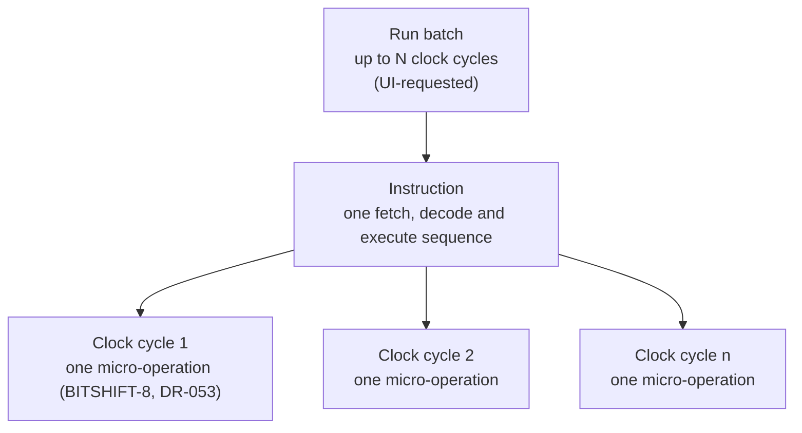
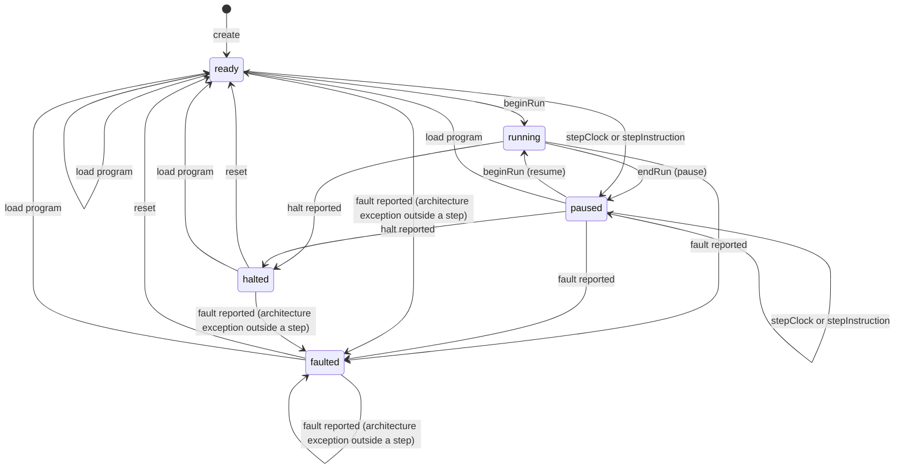

# BITSHIFT — Simulation Platform

**Status:** Stage 0.3, aligned with the approved decisions in [DECISION_REGISTER.md](../decisions/DECISION_REGISTER.md): DR-053, DR-054, DR-056, DR-057, DR-058, DR-061, DR-062, DR-063, DR-066 (as amended) and DR-067 (platform-owned cycle counting). Open items are named with their register IDs.
**Owner module:** `src/platform/`
**Related:** [MODULE_CONTRACTS.md](../contracts/MODULE_CONTRACTS.md) (exact interfaces), [DATA_CONTRACTS.md](../contracts/DATA_CONTRACTS.md), [EVENT_MODEL.md](../contracts/EVENT_MODEL.md), [SYSTEM_ARCHITECTURE.md](SYSTEM_ARCHITECTURE.md), [CPU_ARCHITECTURE_STRATEGY.md](CPU_ARCHITECTURE_STRATEGY.md)

The platform standardises how the application drives any CPU. It does not define how a CPU works, and it contains no CPU-specific knowledge.

---

## 1. Responsibilities

| ID  | Responsibility                          | Notes                                                                      |
| --- | --------------------------------------- | -------------------------------------------------------------------------- |
| P-1 | Architecture registry (type and lookup) | Validates the list supplied by the composition root (DR-057)               |
| P-2 | CPU lifecycle                           | States, transitions, run state (DR-058)                                    |
| P-3 | Execution control                       | Clock-cycle step, instruction step, run batch                              |
| P-4 | Cycle counting                          | The single authoritative cycle counter (DR-067)                            |
| P-5 | Breakpoints                             | Address set and checks, platform-owned                                     |
| P-6 | Events                                  | Stamps cycle and sequence onto architecture events, delivers them in order |
| P-7 | Snapshots                               | Frozen, isolated copies of CPU state, with stable references               |
| P-8 | Instruction history                     | Bounded, configurable, forward-only (DR-056)                               |
| P-9 | Shared types and results                | `Result`, `Diagnostic`, error classes (section 9)                          |

The platform does **not** decode instructions, perform arithmetic, know register names, keep real-time timers, read the system clock, store editor text, or render anything.

---

## 2. Execution Granularity and Cycle Counting

### 2.1 Three Levels, Not Interchangeable

| Term                 | Definition                                                       | Requested by                                                         | Counted in                    |
| -------------------- | ---------------------------------------------------------------- | -------------------------------------------------------------------- | ----------------------------- |
| **Micro-operation**  | One atomic transfer, ALU action or memory access inside a cycle  | Architecture (internal)                                              | Not counted by the platform   |
| **Clock cycle**      | One unit of simulated time. The platform's counter counts these. | —                                                                    | `ClockCycle` (platform)       |
| **Instruction**      | All cycles from one instruction boundary to the next             | —                                                                    | `InstructionRecord` (history) |
| **Clock step**       | Request to advance exactly one cycle                             | `stepClock()`                                                        | Cycle counter                 |
| **Instruction step** | Request to advance to the next instruction boundary              | Controller `stepInstruction()`, composed from `stepClock()` (DR-074) | Cycle counter                 |
| **Run batch**        | Request to run up to `maxCycles` cycles                          | `runBatch(maxCycles)`                                                | Cycle counter                 |

Rules:

1. **Not interchangeable.** A clock step is not an instruction step. The two are different requests, and an instruction step produces exactly the state, events and cycle count of the clock steps it is made of.
2. **Micro-operations are internal.** The platform never sees a micro-operation as a unit of work. It sees cycles and the events the architecture attaches to them.
3. **One micro-operation per cycle is the BITSHIFT-8 model (DR-053, approved with qualification).** The platform does not enforce it. A future architecture declares its own execution semantics (CPU strategy §8.2).

### 2.2 Cycle Counting (DR-067, approved)

The platform owns the **only authoritative cycle counter**. The rules below are normative.

1. **Start.** The counter is 0 after `reset` and after a successful `load`.
2. **Advance.** After each architecture step, the counter increases by exactly `outcome.cyclesCompleted`. It increases by no other amount.
3. **No competing counters.** The architecture reports `cyclesCompleted`, the work done in that step, not a count. It never reports a cycle number. `StepOutcome` carries no cycle counter and no breakpoint information (SC-10, amended).
4. **Failed steps do not advance the counter.** This covers all three failure paths:
   - A `Result` error returned before the architecture is called. The architecture is not called.
   - A step whose outcome carries a `fault`. Its `cyclesCompleted` is 0 by invariant (DATA_CONTRACTS §5).
   - An exception from the architecture. The controller records `PLT-INTERNAL`, and the counter is unchanged.
5. **No duplicate increments.** Halt, fault and breakpoint handling change lifecycle state or report a breakpoint. They never change the counter. A step that reaches halt increments the counter only by the cycles it reports.
6. **Visible values.** The snapshot's `cycle`, every event's `cycle` and every `ControllerUpdate` report the counter after the call. Events receive their absolute cycle from the platform (EVENT_MODEL §2).

Whether a halt instruction consumes a cycle is part of the BITSHIFT-8 cycle specification (DR-011). The rules above hold either way: the platform counts what the architecture reports.

---

## 3. Lifecycle

### 3.1 States

`ready`, `running`, `paused`, `halted`, `faulted` (`CpuState`, DATA_CONTRACTS §4.2).

`reset` is allowed in every state. The UI stops its run loop before it calls `reset` while running.

### 3.2 Request Rules

| Request           | From `ready` or `paused` | From `running`                                         | From `halted` or `faulted` |
| ----------------- | ------------------------ | ------------------------------------------------------ | -------------------------- |
| `load`            | Loads; state → ready     | `PLT-RUNNING` error                                    | Loads; state → ready       |
| `reset`           | Restores post-load state | Restores post-load state (the UI has stopped its loop) | Restores post-load state   |
| `beginRun`        | → running                | `PLT-ALREADY-RUNNING` error                            | `Ok`, no change, 0 cycles  |
| `runBatch(n)`     | `PLT-NOT-RUNNING` error  | Runs up to `n` cycles                                  | `PLT-NOT-RUNNING` error    |
| `endRun`          | `PLT-NOT-RUNNING` error  | → paused                                               | `PLT-NOT-RUNNING` error    |
| `stepClock`       | Runs one cycle           | `PLT-RUNNING` error                                    | `Ok`, no change, 0 cycles  |
| `stepInstruction` | Runs to next boundary    | `PLT-RUNNING` error                                    | `Ok`, no change, 0 cycles  |

Rules:

- A request that cannot make progress because the CPU has halted or faulted returns `Ok` with zero cycles. The state itself explains why nothing ran.
- A request that conflicts with the caller's own run state (for example stepping while running) returns a `Result` error. The caller must change state first.
- A request with no program loaded returns `PLT-NO-PROGRAM`, except `reset`.
- Pause and resume are `endRun` and `beginRun`. Resume continues from the current state. It is not a restart.

### 3.3 Who Owns the Timing (DR-058, approved)

The `running` state is held by the controller. The UI decides when to call `runBatch`. The platform has no real-time timers, so results never depend on machine speed.

---

## 4. Controller Operations

The exact signatures are in [MODULE_CONTRACTS.md](../contracts/MODULE_CONTRACTS.md) §2.4. Summary:

| Operation                               | Purpose                                                                                                                       |
| --------------------------------------- | ----------------------------------------------------------------------------------------------------------------------------- |
| `createController(options)`             | Creates the controller from the architecture list supplied at wiring time. The architecture is fixed for the session (SC-D3). |
| `snapshot()`                            | The current frozen snapshot. Same object until the state changes.                                                             |
| `history()`                             | The current frozen history. Same object until it changes.                                                                     |
| `subscribe(listener)`                   | Receives every `ControllerUpdate`.                                                                                            |
| `load(image)`                           | Loads a program. Clears history and the cycle counter.                                                                        |
| `reset()`                               | Restores post-load state. Cannot fail.                                                                                        |
| `setBreakpoints(addresses)`             | Replaces the breakpoint set. Validated.                                                                                       |
| `beginRun()`, `runBatch(n)`, `endRun()` | Run control (section 3).                                                                                                      |
| `stepClock()`, `stepInstruction()`      | Stepping (section 2).                                                                                                         |
| `readMemory(range)`                     | A copy of part of memory.                                                                                                     |

All operations are synchronous and deterministic. Each call returns `Result` where it can fail, and every call's result is also delivered to subscribers.

---

## 5. Determinism (A)

- The controller has no timers and reads no clock. The only time is the cycle counter.
- `runBatch(maxCycles)` runs up to `maxCycles` cycles. The batch size is a count, not a time budget, so the result never depends on machine speed.
- No randomness, and no unordered iteration in platform or architecture code.
- The same sequence of calls on the same architecture produces the same snapshots, events and history.

---

## 6. Breakpoints

- A breakpoint is an address, validated against `[0, 2^addressBits)`. The architecture never receives it.
- **During `runBatch`:** the controller compares the snapshot's `programCounter` with the set after each instruction boundary. A match stops the batch, and the update carries `breakpointHit`.
- **During `stepClock` and `stepInstruction`:** the controller does not stop, because the step already completed. If the resulting program counter is in the set, the update reports `breakpointHit`. Whether clock steps should also stop is open (DR-027).
- The breakpoint program counter comes from the architecture's snapshot, so breakpoints do not depend on the deferred descriptor field (SC-14, DR-022).
- Breakpoints persist across `load` and `reset`.

---

## 7. Events and Snapshots

### 7.1 Strategy

The chosen strategy is a **snapshot at each stop point plus self-describing events** (recommended in Stage 0.2, adopted in DR-056).

| Element             | Purpose                                                                            |
| ------------------- | ---------------------------------------------------------------------------------- |
| Snapshot            | The true current state, for inspection and for every panel that shows values       |
| Events              | What changed in each cycle, with before and after values, for animation and replay |
| Instruction records | Compact history for the timeline                                                   |

The consistency invariant is defined in EVENT_MODEL §5. In short: applying a cycle's state-changing events in order to the previous snapshot must produce the next snapshot, for the replayable fields.

### 7.2 Previous State

The application keeps the previous snapshot as well as the current one, so the UI can show before and after for the latest update. That is one extra object, not a history.

### 7.3 Stable References (SC-28)

- The controller keeps the current snapshot object. It creates a new one only when the state changes.
- Repeated reads return the same reference, so `useSyncExternalStore` never sees a spurious change.
- The application layer owns the React adapter (MODULE_CONTRACTS §1.4). React stays outside the simulation core.

### 7.4 Snapshot Isolation

Snapshots never share mutable state with the architecture or with each other.

- The architecture returns a `CpuStateCopy` built from new arrays and a new `memory` array (DATA_CONTRACTS §4.1).
- The platform copies it into a new snapshot and freezes the snapshot object and its arrays.
- `memory` cannot be frozen. Consumers treat it as read-only, and every memory read returns a new copy.
- Events and records are frozen when published.
- A test takes a snapshot, steps the CPU, and checks that the earlier snapshot is unchanged (TEST_STRATEGY §4).

---

## 8. Instruction History (DR-056, approved with qualifications)

The history stores one `InstructionRecord` per instruction (EVENT_MODEL §10). It keeps the current and previous snapshots only, and clears its clock-level events on each instruction.

| Requirement (DR-056)           | How it is met                                                                                                                                                                           |
| ------------------------------ | --------------------------------------------------------------------------------------------------------------------------------------------------------------------------------------- |
| Bounded                        | `createExecutionHistory(limit)` enforces the limit on every `append`                                                                                                                    |
| Configurable                   | `historyLimit` is a required controller option. Its default is DR-024 and is not fixed here.                                                                                            |
| Safely discardable             | Eviction, `clear` and reset change only the history. Snapshots and events already delivered are unaffected. Records are immutable, so discarding invalidates no reference the UI holds. |
| No shared mutable state        | Records are built from copies of event values and are frozen                                                                                                                            |
| Measured during implementation | Phase 1 measures the append cost and memory at the default limit against DR-031                                                                                                         |

Eviction is oldest first, and `truncated` becomes true so the timeline can show that earlier entries were removed. The timeline is forward-only (MVP-021, EX-05).

Capacity and default value remain open under DR-024.

---

## 9. Error Classes and Handling

The platform uses three error classes. The distinction is part of the contract, because each class has a different effect on the state.

| Class            | Meaning                                                     | Mechanism                                        | State effect                                                                            | Example                                                  |
| ---------------- | ----------------------------------------------------------- | ------------------------------------------------ | --------------------------------------------------------------------------------------- | -------------------------------------------------------- |
| **Result error** | The caller asked for something invalid or at the wrong time | `Result` with a `Diagnostic`                     | None. The architecture is not called.                                                   | `PLT-RUNNING`, `PLT-BREAKPOINT-RANGE`, `ARCH-UNKNOWN-ID` |
| **Fault**        | The simulated CPU reached an illegal condition              | `StepOutcome.fault`, reported as a `fault` event | State → `faulted`; `lastFault` set; no cycle counted                                    | An undefined opcode (DR-016)                             |
| **Exception**    | A programmer error or an invariant violation                | Caught at the controller boundary                | State → `faulted` with `PLT-INTERNAL`; no cycle counted; instance treated as unreliable | An architecture throws                                   |

Further rules:

- A Result error never changes the state, the counter, the history or the breakpoint set.
- An exception is never swallowed. The controller records it as `PLT-INTERNAL`, and it is logged to the console in development.
- After an exception, the controller creates a new instance on the next `reset` and reloads the last program. Until then, step and run requests return `Ok` with zero cycles.
- A missing explanation is none of these. It is optional metadata, shown as generic text, and it never affects execution (DR-061).
- History eviction is not an error. The timeline shows the truncation notice.

Full MODULE-level rules are in MODULE_CONTRACTS §2.4.

---

## 10. Execution Environment and Performance

### 10.1 Main Thread (DR-033, proposed)

The simulation runs on the main thread in v1.0. The workload is small: 256 bytes of memory, a few registers, and short educational programs. Batches are counted, and the UI publishes at most once per animation frame (DR-034, refined in Stage 0.2). A Web Worker is not required by any approved decision. It remains an option if DR-031 targets are missed.

### 10.2 Run Loop and Speed (DR-046, open)

- The UI calls `runBatch(n)` once per animation frame while running. `n` comes from the speed preset.
- Presets change `n` and animation timing. They never change results.
- Event coalescing in fast presets is a UI rule. It does not change the events the controller produces (DR-032).

### 10.3 Responsiveness Targets

Targets are in PRODUCT_SPEC S-7. DR-031 is open: it combines a UI frame budget with a core throughput measure, and the reference machine is undefined. The design supports the targets through constant-size snapshots, bounded history, counted batches and one publish per frame. The measurements belong to Phase 1 (core) and Phase 4 (rendering).

---

## 11. Non-Responsibilities

- Rendering, animation and layout (visualization and workbench).
- Assembly rules (assembler).
- Editor text persistence (application layer, DR-063).
- Real-time timers and run scheduling (UI, DR-058).
- Choosing or listing architectures (composition root, DR-057).
- Instruction explanation text (architecture, DR-061).
- Sharing or networking (out of v1.0).
