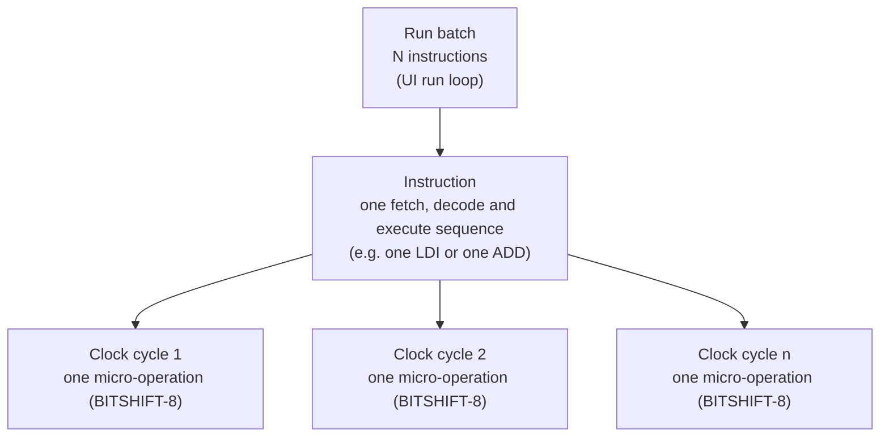
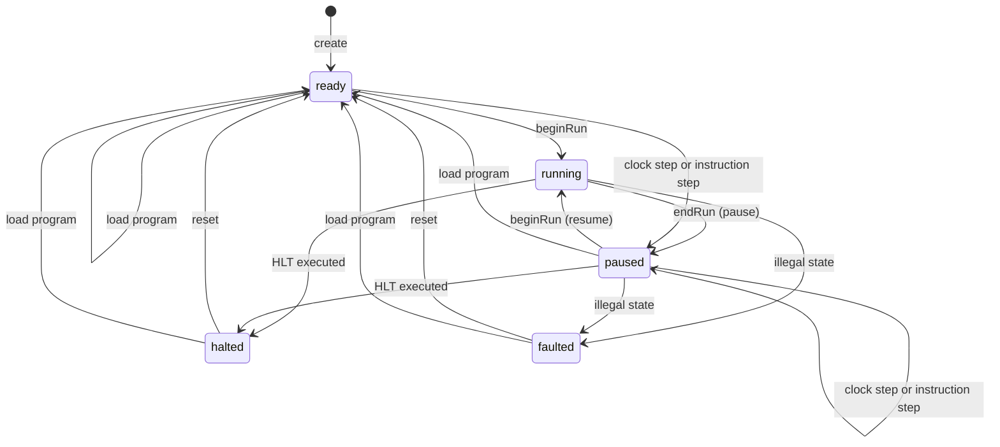

# BITSHIFT — Simulation Platform

**Status:** Stage 0.2, reconciled after product-owner review. Decisions marked **Approved** are approved in [DECISION_REGISTER.md](../decisions/DECISION_REGISTER.md) section B2 (DR-053, DR-056, DR-058 and others). Items marked **[A]** are product-owner established. Open items are marked **[C]** and are listed in section C of the register.
**Owner module:** `src/platform/`
**Related:** [SYSTEM_ARCHITECTURE.md](SYSTEM_ARCHITECTURE.md), [CPU_ARCHITECTURE_STRATEGY.md](CPU_ARCHITECTURE_STRATEGY.md), [EVENT_MODEL.md](../contracts/EVENT_MODEL.md), [DATA_CONTRACTS.md](../contracts/DATA_CONTRACTS.md), [MODULE_CONTRACTS.md](../contracts/MODULE_CONTRACTS.md)

The platform standardises how the application drives any CPU. It does not define how a CPU works, and it contains no CPU-specific knowledge.

---

## 1. Responsibilities

| ID  | Responsibility                          | Notes                                                                    |
| --- | --------------------------------------- | ------------------------------------------------------------------------ |
| P-1 | Architecture registry (type and lookup) | The list of architectures is supplied at wiring time (DR-057, approved). |
| P-2 | CPU lifecycle                           | Create, load, reset, run state, halt, fault.                             |
| P-3 | Execution control                       | Clock-level step, instruction step, run batch.                           |
| P-4 | Breakpoints                             | Address set, checked by the controller, not by the CPU.                  |
| P-5 | Event collection and delivery           | Collects typed events from each step and delivers them in order.         |
| P-6 | Snapshots                               | Immutable copies of CPU state.                                           |
| P-7 | Instruction history                     | Bounded, forward-only, configurable limit (DR-056, approved).            |
| P-8 | Shared types                            | `Result`, `Diagnostic`, `SourceSpan`, cycle counter.                     |

The platform does **not** decode instructions, perform arithmetic, know register names, keep real-time timers, read the clock, or render anything (DR-058, approved).

## 2. Execution Granularity

The brief requires instruction-level execution, clock-cycle execution and internal micro-operation execution to be treated as different things. This section defines them.



| Term                 | Definition                                                                                             | Unit of time               | Produced by              | Visible to learner as                                |
| -------------------- | ------------------------------------------------------------------------------------------------------ | -------------------------- | ------------------------ | ---------------------------------------------------- |
| **Micro-operation**  | One atomic transfer of a value between components, or one ALU operation, or one memory access          | None (it occupies a cycle) | Architecture             | The active step label, control signals, bus activity |
| **Clock cycle**      | One tick of the simulated CPU clock. The unit of simulated time. The platform counts cycles.           | One cycle                  | Platform counts cycles   | "Cycle n" in the control panel                       |
| **Instruction**      | The full sequence of micro-operations for one instruction, from fetch to the next instruction boundary | Several cycles             | Architecture             | Timeline entry, instruction explanation (MVP-022)    |
| **Clock-level step** | User action that advances exactly one clock cycle                                                      | One cycle                  | Controller               | MVP-013                                              |
| **Instruction step** | User action that advances to the next instruction boundary                                             | Several cycles             | Controller               | MVP-012                                              |
| **Run batch**        | Requested by the UI, executes N instruction steps without rendering each one                           | Several instructions       | Controller, called by UI | Run and pause                                        |

### 2.1 Rules

1. **Not interchangeable.** A clock-level step is not an instruction step. Running an instruction step is not the same as taking all of its clock-level steps.
2. **Cycles are counted, not instructions.** `CpuSnapshot.tick` (DATA_CONTRACTS) is the clock cycle counter. Instruction counts are kept separately in history.
3. **One micro-operation per cycle: approved for BITSHIFT-8 (DR-053, approved with qualification).** This is the execution model for the initial BITSHIFT-8 implementation. It is not a permanent restriction on every architecture. The platform does not hard-code it: the platform treats a clock cycle as an opaque step, counts cycles, and never checks how many micro-operations a cycle contains. A future architecture with different execution semantics declares them through its own descriptor (CPU strategy §8.2). Keep the v1.0 implementation simple and deterministic.
4. **Breakpoints are instruction-level.** They are checked at instruction boundaries (DR-027, open).
5. **Events are per micro-operation.** One event batch is produced for each clock cycle, and each event is tagged with its cycle.

### 2.2 Why not "step = instruction" only

The product requires clock-level stepping (MVP-013) and control-signal display (MVP-019). Instruction-level granularity alone would hide the sequence the product exists to show.

### 2.3 Dependency on Open Decisions

DR-053 is approved, so the one-micro-operation-per-cycle model is the BITSHIFT-8 execution model. The number of cycles per instruction and the sequence of micro-operations are not yet decided. They are in DR-011, which blocks clock-level execution. The micro-operation representation is in DR-013, and only its internal part blocks Phase 2 (register finding R-02). The granularity rules above therefore define the model, but the BITSHIFT-8 sequences are not specified here.

## 3. Lifecycle

### 3.1 States

`ready`, `running`, `paused`, `halted`, `faulted` (the `CpuState` type in DATA_CONTRACTS).



### 3.2 Rules

- `beginRun` and `endRun` change state. `runBatch` is allowed only in `running`.
- Pause and resume are `endRun` and `beginRun`. Resume continues from the current state. It is not Run from the start.
- `reset` is allowed in every state. It returns to `ready` with the program still loaded.
- `load program` is allowed in every state except `running`. The controller refuses it while running, and the UI must pause first.
- Rejected loads leave state unchanged.
- In `halted` or `faulted`, step and run requests return the current state with no events.

Who owns the timing (DR-058, approved): `running` is a state the controller holds. The UI decides when to call `runBatch`. The platform has no real-time timers, so results never depend on machine speed.

## 4. Controller Operations (conceptual)

| Operation                       | Effect                                                                         | Allowed in states              |
| ------------------------------- | ------------------------------------------------------------------------------ | ------------------------------ |
| `create` / `selectArchitecture` | Creates an instance from a registry entry supplied at wiring time              | Any (no instance yet)          |
| `load(programImage)`            | Loads a program; clears history and events                                     | ready, paused, halted, faulted |
| `reset()`                       | Restores post-load state; clears history                                       | Any                            |
| `stepClock()`                   | Advances one clock cycle                                                       | ready, paused                  |
| `stepInstruction()`             | Advances to the next instruction boundary                                      | ready, paused                  |
| `beginRun()`                    | Sets state to running                                                          | ready, paused                  |
| `runBatch(n)`                   | Executes up to n instruction steps; stops early at a breakpoint, halt or fault | running                        |
| `endRun()`                      | Sets state to paused                                                           | running                        |
| `setBreakpoints(addresses)`     | Replaces the breakpoint set                                                    | Any                            |
| `subscribe(listener)`           | Receives `ControllerUpdate` after each call that changes state                 | Any                            |

Every operation returns `Result` where it can fail, or nothing where it cannot. Operations are synchronous. The exact signatures are a Stage 0.3 item (CPU strategy §4.3).

## 5. Determinism (A)

- The controller has no real-time timers and reads no clock. The only time is the cycle counter.
- `runBatch(n)` executes exactly n instruction steps unless it stops at a breakpoint, halt or fault. The batch size is a count, not a time budget, so the result never depends on machine speed.
- No randomness and no unordered iteration in platform or architecture code.

## 6. Breakpoints

- A breakpoint is an address for BITSHIFT-8, or any value the architecture's program counter can hold (DR-022, proposed).
- During `runBatch`, the controller checks the program counter at each instruction boundary and stops if it matches a breakpoint.
- During `stepClock`, breakpoints are not checked (DR-027, open). The step result reports if the current PC is at a breakpoint, so the UI can show it.
- Breakpoints are platform data. The CPU does not know they exist.

## 7. Events and Snapshots

### 7.1 Options Evaluated

| Option                                          | Description                                                                                             | Visualization                                         | Debugging                             | History                         | Performance                                                     | Reverse execution (v2)                                     |
| ----------------------------------------------- | ------------------------------------------------------------------------------------------------------- | ----------------------------------------------------- | ------------------------------------- | ------------------------------- | --------------------------------------------------------------- | ---------------------------------------------------------- |
| **1. Snapshot per step**                        | Full immutable copy after every cycle                                                                   | Must diff two snapshots to find changes. Error-prone. | Easy to inspect any state             | Heavy if many kept              | Copy per cycle; trivial for 256 bytes but grows with state size | Possible by keeping snapshots                              |
| **2. Event stream only**                        | Typed events; state is rebuilt by applying them                                                         | Simple deltas                                         | Needs replay to see a past state      | Compact                         | Very cheap                                                      | Possible by undoing events                                 |
| **3. Snapshot plus event deltas (recommended)** | Snapshot at each stop point; each event records before and after values; instruction records in history | Each event says what changed; no diffing              | Snapshot gives the true current state | Compact: records, not snapshots | Cheap                                                           | Possible: undo with before values, or periodic checkpoints |

**Recommendation: Option 3.** It gives the visualization self-describing events, gives the learner and developers a true state to inspect, and keeps history small. It does not need event sourcing or a distributed event bus. The recommendation was reviewed in the Stage 0.2 closeout and is adopted as the basis of DR-056.

### 7.2 Consistency Invariant

For every clock cycle, applying that cycle's events to the previous snapshot gives the next snapshot. This is a testable property. A failure means the events are incomplete or the snapshot is wrong. It is a key test in the platform test suite (TEST_STRATEGY).

### 7.3 Previous State

The store keeps the previous snapshot as well as the current one, so the UI can show "before" and "after" for the latest step. This is one copy, not a history.

### 7.4 Event Shape (summary)

Events carry: a kind, the clock cycle, a sequence number within the cycle, and a payload. Payloads for state-changing kinds include before and after values. Micro-operation events carry the names of the active control signals (DR-053, approved; MVP-019). Full definitions are in [EVENT_MODEL.md](../contracts/EVENT_MODEL.md). That document needs the changes listed in CPU strategy §4.3 (DR-066, Stage 0.3).

### 7.5 Snapshot Isolation (DR-056 qualification)

Snapshots must not share mutable CPU state, by accident or otherwise.

- Every snapshot is built from copies. Memory is copied as a new byte array, never a view into the instance's memory.
- Register and flag lists are new arrays of new objects.
- Callers receive snapshots that they can keep. Later steps never change a snapshot already delivered.
- Events carry values, not references to instance state.
- The platform's conformance test mutates the instance after taking a snapshot and checks that the earlier snapshot is unchanged.

## 8. Instruction History

### 8.1 Record Shape

Per DR-056 (approved), one record is kept per instruction. The field list follows the approved proposal. The final type is a Stage 0.3 item (EVENT_MODEL §7).

```ts
// Shape per DR-056; the explanation is optional per DR-061.
interface InstructionRecord {
  readonly index: number; // 0-based within this run
  readonly startCycle: number; // clock cycle of the first micro-operation
  readonly endCycle: number; // clock cycle of the last micro-operation
  readonly address: number; // architecture address of the instruction
  readonly mnemonic: string; // from the ISA descriptor
  readonly changes: readonly {
    // before and after values, copied from events
    readonly target: string; // register name, flag name or memory address
    readonly before: number | boolean;
    readonly after: number | boolean;
  }[];
  readonly explanation?: string; // optional descriptive metadata (DR-061); absent means generic text
}
```

### 8.2 Decisions

| Item                           | Decision                                                                         | Status                                   |
| ------------------------------ | -------------------------------------------------------------------------------- | ---------------------------------------- |
| What is stored per instruction | Instruction record above, not a snapshot                                         | Approved (DR-056)                        |
| Current and previous state     | Full snapshots for the current and previous state only                           | Approved (DR-056)                        |
| Clock-level events             | Kept only for the latest instruction, so the control panel can show its steps    | Approved (DR-056)                        |
| Limit                          | Bounded. The limit is configurable. Default 10,000 records.                      | Approved (DR-056); default open (DR-024) |
| Eviction                       | Oldest first. The timeline shows "earlier entries removed" once eviction starts. | Approved as part of DR-056 requirement 3 |
| Forward only                   | Yes. No backward navigation in v1.0 (EX-05).                                     | [A] (MVP-021)                            |
| Reset and load                 | Clear history                                                                    | Proposed                                 |

### 8.3 Approved Requirements for History (DR-056 qualifications)

1. **Bounded.** The history never grows without limit. The limit is enforced on every append.
2. **Configurable.** The limit is an option supplied when the controller is created (for example `historyLimit`). The default is not fixed by this document; it is DR-024.
3. **Safely discardable.** Discarding old records (eviction, reset, load) must never affect the current state, the current or previous snapshot, or events already delivered to subscribers. Records are immutable once written, so the UI holds copies and discarding cannot invalidate a reference. Discarding is a bookkeeping operation with no effect on simulation results.
4. **No shared mutable state.** Records are built from copies of event values. They are frozen by convention (`readonly` types) and are never linked to instance state (see 7.5).
5. **Performance measured during implementation.** Phase 1 measures the cost of appending records and the memory used at the default limit. The measurements are recorded and compared with DR-031.

### 8.4 Memory Estimate

Each record is small: a few numbers, a mnemonic, a short list of changes and an optional explanation. Typical records are well under 1 KB. At the default limit, the worst case is on the order of a few megabytes. This is an estimate and must be measured as required in 8.3(5).

## 9. Error Handling

| Situation                                   | Behaviour                                                                                                                           |
| ------------------------------------------- | ----------------------------------------------------------------------------------------------------------------------------------- |
| Architecture reports an illegal state       | Controller moves to `faulted`, emits a `fault` event with a diagnostic, and stops advancing.                                        |
| Program load rejected                       | Returns a `Result` error. State unchanged.                                                                                          |
| Unknown architecture ID                     | Returns a `Result` error. No instance created.                                                                                      |
| Breakpoint address out of range             | Returns a `Result` error. Breakpoint set unchanged.                                                                                 |
| Unexpected exception inside an architecture | Caught at the controller boundary. State becomes `faulted` with the message. The exception is logged to the console in development. |
| Missing explanation text (DR-061)           | Not an error and not a fault. The timeline shows generic text. Execution is unaffected.                                             |
| History eviction                            | Not an error. The timeline shows that earlier entries were removed.                                                                 |
| Visualization transform fails               | Not a simulation error. The UI keeps the last good view and shows a notice.                                                         |

Errors are `Result` values at API boundaries. Exceptions are for programmer errors ([CODING_STANDARDS.md](../engineering/CODING_STANDARDS.md)).

## 10. Execution Environment and Performance

### 10.1 Main Thread or Web Worker

| Option                                 | Advantages                                                                                                        | Disadvantages                                                                                                                                |
| -------------------------------------- | ----------------------------------------------------------------------------------------------------------------- | -------------------------------------------------------------------------------------------------------------------------------------------- |
| **Main thread (recommended for v1.0)** | Simple. No serialisation of snapshots. Easy debugging with browser tools. Immediate access to controller from UI. | A very heavy run could block rendering if not batched.                                                                                       |
| Web Worker                             | Keeps UI responsive under heavy load                                                                              | Every snapshot and event must be serialised. Adds message protocol and lifecycle code. Harder to debug. Two copies of state to keep in step. |

**Recommendation:** main thread in v1.0 (DR-033, proposed). The workload is small: 256 bytes of memory, a handful of registers, and short educational programs. Batching by instruction count and publishing once per frame keep the UI responsive. The switch to a worker remains possible because the controller interface is already message-shaped (copies in, copies out). It is not needed now, and it is not required by any approved decision.

### 10.2 Run Loop and Speed Control

- The UI run loop calls `runBatch(n)` once per animation frame while in `running` state. `n` comes from the speed preset (DR-046, open).
- Presets change `n` (how much simulation runs per frame) and animation duration. They never change results.
- Animation-off mode runs larger batches with no per-cycle animation.
- Because batches are counted, two presets reach the same final state for the same program.

### 10.3 Event Coalescing

When a batch runs many instructions in one frame, the visualization cannot animate every cycle. The rule is:

- In step modes and slow presets, every cycle is shown.
- In fast presets, the visualization shows the final state of the batch and the last instruction's events. History still records every instruction.

This is a UI rule. It does not change the events the controller produces (DR-032).

### 10.4 Publish Rate

The store publishes to the UI at most once per frame (refines DR-034). The UI re-renders only changed panels. The memory grid (256 cells) updates only changed cells.

### 10.5 Responsiveness Targets

Targets are in PRODUCT_SPEC S-7 and DR-031. DR-031 is open: it combines a UI frame budget and a core throughput measure, and the reference machine is undefined (register finding R-03). The architecture supports the targets by:

- constant-size snapshots,
- bounded history,
- count-based batches,
- one publish per frame.

These targets must be measured in Phase 1 (core) and Phase 4 (rendering). If they are missed, the response order is: reduce publish frequency, then coalesce more, then consider a worker (DR-033).

## 11. Non-Responsibilities

- Rendering, animation and layout (visualization and workbench).
- Assembly rules (assembler).
- Persistence of editor text (application layer, DR-063, approved).
- Sharing or networking (out of v1.0).
- Choosing or listing architectures (composition root, DR-057, approved).
- Real-time timers and run scheduling (UI, DR-058, approved).
- Instruction explanation text (architecture, DR-061, approved).
