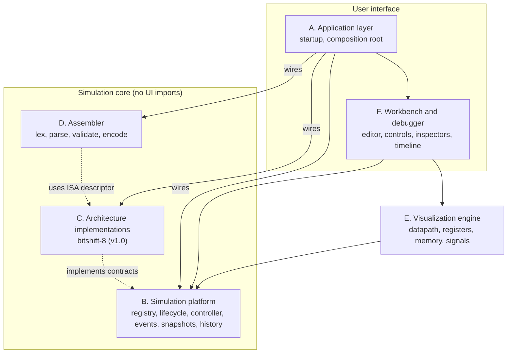
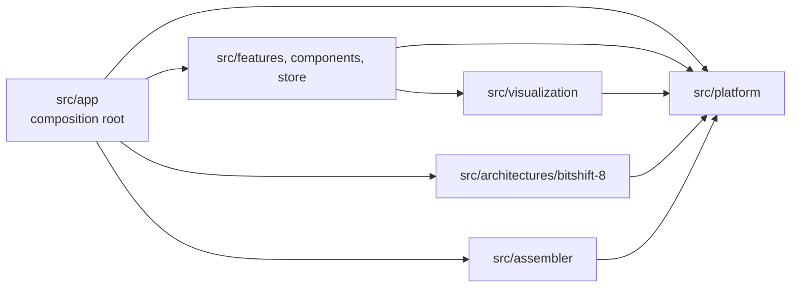
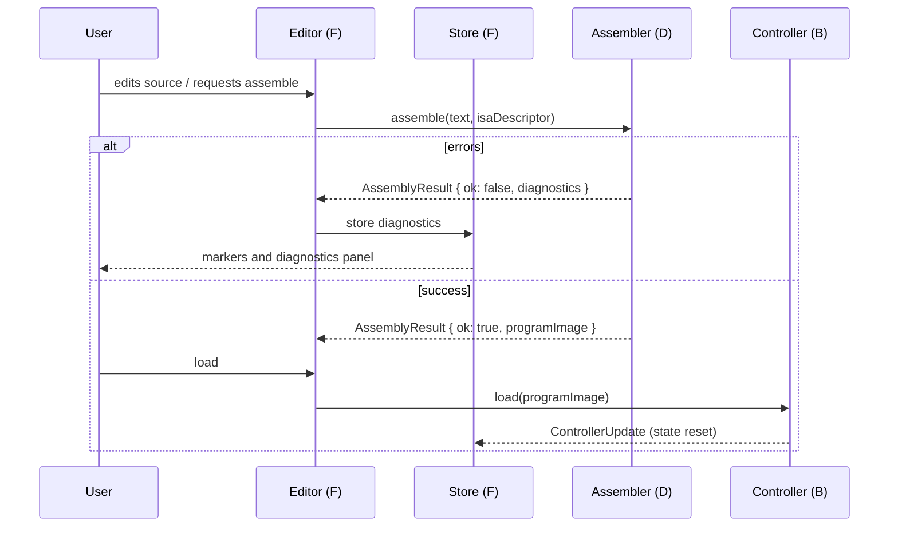
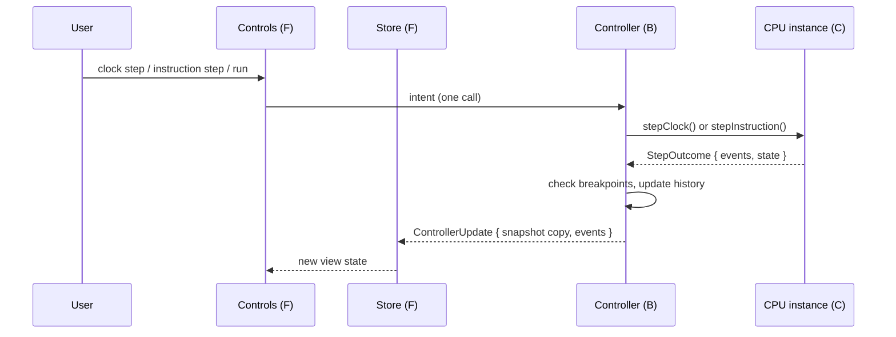
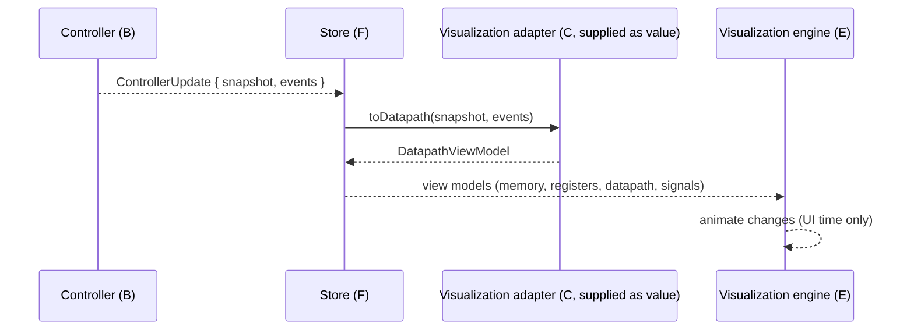
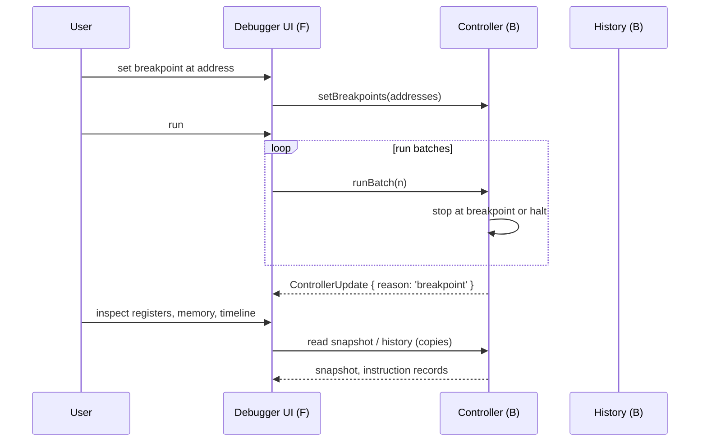

# BITSHIFT — System Architecture

**Status:** Proposed (Stage 0.2). Architecture decisions here are **[B]** proposals unless marked **[A]**. Nothing is approved until the product owner approves the items in [DECISION_REGISTER.md](../decisions/DECISION_REGISTER.md) section B2.
**Related:** [SIMULATION_PLATFORM.md](SIMULATION_PLATFORM.md), [CPU_ARCHITECTURE_STRATEGY.md](CPU_ARCHITECTURE_STRATEGY.md), [TECHNOLOGY_STACK.md](TECHNOLOGY_STACK.md), [ADR-001](../decisions/ADR-001-modular-simulation-platform.md), [PRODUCT_SPEC.md](../product/PRODUCT_SPEC.md), [MVP_SCOPE.md](../product/MVP_SCOPE.md)

---

## 1. Purpose and Scope

This document defines the subsystems of BITSHIFT v1.0, their responsibilities and boundaries, how they depend on each other, how data flows between them, and who owns each piece of state. It does not define the BITSHIFT-8 instruction set, register layout or micro-operation sequences. Those belong to [BITSHIFT-8_ISA.md](../specifications/BITSHIFT-8_ISA.md) and the later CPU design stages.

## 2. Architectural Principles

| ID    | Principle                                                                                                                | Source      |
| ----- | ------------------------------------------------------------------------------------------------------------------------ | ----------- |
| AP-01 | Simulation is independent of presentation. CPU, assembler and platform code never import React, the DOM or UI libraries. | [A] A-06    |
| AP-02 | Simulation is deterministic. Same program and inputs give the same snapshots and events.                                 | [A] A-07    |
| AP-03 | The UI never modifies CPU internals. It sends intents and reads copies.                                                  | [A] A-08    |
| AP-04 | Data crossing a subsystem boundary is an explicitly typed value, never a live object.                                    | [A] A-09    |
| AP-05 | Each architecture owns its hardware semantics. Shared code does not assume identical registers, word sizes or formats.   | [A] A-10    |
| AP-06 | Prefer plain modules and interfaces to plugin frameworks, containers or services.                                        | [B]         |
| AP-07 | No backend. Everything runs in the browser.                                                                              | [A] A-02    |
| AP-08 | Visualizations show what the CPU did. They never compute CPU results.                                                    | [A] PRIN-03 |

## 3. Subsystem Overview

The brief describes six areas. This document uses that split. Compared with the earlier five-area model, the **Application layer** (A) now covers only startup and composition, and the **Workbench and Debugger** (F) is separate.

Solid arrows mean "calls or uses". Dotted arrows mean "implements a contract or receives a value supplied at wiring time".

## 4. Subsystem Responsibilities

| Area                                | Directory (proposed)                             | Owns                                                                                                                                                                                                               | Does not own                                           |
| ----------------------------------- | ------------------------------------------------ | ------------------------------------------------------------------------------------------------------------------------------------------------------------------------------------------------------------------ | ------------------------------------------------------ |
| **A. Application layer**            | `src/app/`                                       | Startup, the composition root (where architectures, assembler and platform are wired together), global error boundary, persistence adapter for editor text (DR-048)                                                | Any simulation logic, any panel design                 |
| **B. Simulation platform**          | `src/platform/`                                  | Architecture registry _type and lookup_ (no concrete architectures), CPU lifecycle, execution controller, event collection, snapshot copying, bounded history, breakpoints, shared `Result` and `Diagnostic` types | Registers, instructions, arithmetic, rendering, timers |
| **C. Architecture implementations** | `src/architectures/<id>/`                        | Registers, flags, memory, ALU, decoding, micro-operation sequences, ISA descriptor, instruction explanations, visualization adapter                                                                                | UI, generic run loop, assembler rules                  |
| **D. Assembler**                    | `src/assembler/`                                 | Lexical analysis, parsing, instruction validation, symbols and labels, address resolution, machine code, source map, diagnostics                                                                                   | Execution, UI, any specific architecture module        |
| **E. Visualization engine**         | `src/visualization/`                             | SVG datapath layout, animations, transforms from view models to drawn elements                                                                                                                                     | Any CPU state, any CPU logic, any architecture module  |
| **F. Workbench and debugger**       | `src/features/`, `src/components/`, `src/store/` | Editor integration (CodeMirror), execution controls, inspectors, timeline view, breakpoint toggles, UI state, UI-side run scheduling                                                                               | Simulation logic, direct CPU access                    |

Each area exposes one public entry point (`index.ts`). Other files in the directory are internal.

## 5. Platform Modules (proposed)

These are the modules inside area B. They are proposals for Phase 1 and do not require separate packages.

| Module        | Responsibility                                                                                   | Depends on                                                   |
| ------------- | ------------------------------------------------------------------------------------------------ | ------------------------------------------------------------ |
| `registry`    | Type of a registry entry; lookup by ID; list of entries supplied at wiring time                  | Platform types only                                          |
| `lifecycle`   | State machine (`ready`, `running`, `paused`, `halted`, `faulted`) and transition rules           | Platform types                                               |
| `controller`  | Single entry point for the UI: load, reset, clock step, instruction step, run batch, breakpoints | `lifecycle`, `events`, `snapshots`, `history`, `breakpoints` |
| `events`      | Event envelope, ordering, batching, subscription delivery                                        | Platform types                                               |
| `snapshots`   | Copies CPU state into an immutable snapshot                                                      | Platform types                                               |
| `history`     | Bounded list of instruction records for the timeline (see SIMULATION_PLATFORM §8)                | `events` types                                               |
| `breakpoints` | Address set and the check at instruction boundaries                                              | Platform types                                               |
| `result`      | `Result`, `Diagnostic`, `SourceSpan` helpers                                                     | None                                                         |

## 6. Dependency Rules

### 6.1 Allowed Dependencies

Read the diagram as: a module may import from the modules it points to. Anything not shown is forbidden.

### 6.2 Rules

| ID     | Rule                                                                                                                                                                                          | Change from earlier draft                                                                                                                  |
| ------ | --------------------------------------------------------------------------------------------------------------------------------------------------------------------------------------------- | ------------------------------------------------------------------------------------------------------------------------------------------ |
| DEP-01 | `src/platform` imports nothing from `src/architectures`, `src/assembler`, `src/visualization` or `src/features`.                                                                              | **Corrected.** The earlier draft put the concrete architecture list inside `src/platform/registry.ts`. That is no longer allowed (DR-057). |
| DEP-02 | `src/architectures/<id>` imports only `src/platform` (types and helpers). It never imports another architecture or the assembler.                                                             | Unchanged                                                                                                                                  |
| DEP-03 | `src/assembler` receives the ISA descriptor as an argument. It imports `src/platform` types only, never `src/architectures`.                                                                  | **Corrected.** The earlier draft let the assembler import the target architecture (DR-060).                                                |
| DEP-04 | `src/visualization` imports `src/platform` types only. It receives a visualization adapter as a value. It never imports `src/architectures` (DR-062).                                         | **Corrected.** The earlier draft allowed visualization to consume architecture modules through the store.                                  |
| DEP-05 | `src/features` and `src/components` may import `src/platform` (types, controller interface), `src/visualization` and `src/store`. They never import `src/architectures` or `src/assembler`.   | New                                                                                                                                        |
| DEP-06 | `src/app` is the only module that imports concrete architectures and the assembler. It wires them together.                                                                                   | New (composition root)                                                                                                                     |
| DEP-07 | No module imports React, Zustand, CodeMirror, Motion or Tailwind except `src/features`, `src/components`, `src/store`, `src/visualization` (React and SVG rendering) and `src/app` (startup). | New                                                                                                                                        |
| DEP-08 | No cycles between areas.                                                                                                                                                                      | Unchanged; enforced by review until lint tooling is approved (DR-021)                                                                      |

Why the composition root: the platform, assembler and visualization must stay ignorant of which CPUs exist. Only startup knows the list. This is how BITSHIFT-16 or RISC-V can be added later without changing platform code (see [CPU_ARCHITECTURE_STRATEGY.md](CPU_ARCHITECTURE_STRATEGY.md) §4).

### 6.3 Enforcement

- Review checklist in [CODING_STANDARDS.md](../engineering/CODING_STANDARDS.md) section 3.
- Import rules through lint tooling, if approved (DR-021).
- Phase 1 includes a test that scans imports under `src/platform` and fails on any forbidden path. This test uses no new dependency.

## 7. State Ownership

| State                                                                        | Owner                                               | Read by                    | Written by                         | Rule                                                |
| ---------------------------------------------------------------------------- | --------------------------------------------------- | -------------------------- | ---------------------------------- | --------------------------------------------------- |
| Architecture-specific CPU state (registers, memory, flags, internal latches) | Architecture instance (C)                           | Snapshot builder only      | Instance step methods only         | No other module holds a reference                   |
| Execution coordination (lifecycle state, tick counter, batch position)       | Controller (B)                                      | Store, features            | Controller methods                 | UI requests changes through controller methods only |
| Breakpoint set                                                               | Controller (B)                                      | Controller                 | Controller, on UI intent           | Breakpoints are not CPU data                        |
| Execution history (instruction records)                                      | History module (B)                                  | Timeline view, debugger    | Controller, after each instruction | Bounded; forward only                               |
| Program image and source map                                                 | Assembler output, held by the controller after load | Controller, editor markers | Assembler (one-time output)        | Immutable after creation                            |
| Diagnostics                                                                  | Assembler (D)                                       | Editor, diagnostics panel  | Assembler                          | Replaced on each assembly run                       |
| Copied snapshots and event batches                                           | Store (F), copies from controller                   | Visualization, inspectors  | Store, on controller notification  | Store never keeps a live instance                   |
| Editor text                                                                  | Editor component (F), persisted by app (A)          | Assembler trigger          | Editor                             | Persisted only in browser storage (DR-048)          |
| Visual state (animation progress, highlights, layout)                        | Visualization (E) and features (F)                  | Renderer                   | Renderer                           | Derived; never written back to simulation           |
| Speed preset, panel layout                                                   | Store (F)                                           | UI                         | UI                                 | UI state only; never affects results (DR-046)       |

## 8. Data Flow Workflows

### 8.1 Workflow A — Assembly

| Aspect         | Detail                                                                                                                                                             |
| -------------- | ------------------------------------------------------------------------------------------------------------------------------------------------------------------ |
| Initiated by   | User (assemble and load actions)                                                                                                                                   |
| Processed by   | Assembler (D) is a pure function; controller (B) loads                                                                                                             |
| Data exchanged | Source text in; `AssemblyResult` out; `ProgramImage` into the controller                                                                                           |
| State owner    | Assembler owns nothing after returning; controller owns the loaded program; store owns diagnostics                                                                 |
| Errors         | Returned as `Diagnostic` values with spans. Assembly never throws for user input. A rejected load returns a `Result` error and leaves the CPU unchanged (MVP-005). |

### 8.2 Workflow B — Execution

| Aspect         | Detail                                                                                                                                                                                                                |
| -------------- | --------------------------------------------------------------------------------------------------------------------------------------------------------------------------------------------------------------------- |
| Initiated by   | User via controls, or the UI run loop (F) calling `runBatch`                                                                                                                                                          |
| Processed by   | Controller (B) coordinates; CPU instance (C) executes                                                                                                                                                                 |
| Data exchanged | Intent in; `StepOutcome` from instance; `ControllerUpdate` out                                                                                                                                                        |
| State owner    | Instance owns CPU state; controller owns lifecycle and breakpoints                                                                                                                                                    |
| Errors         | Illegal state → instance returns a fault outcome; controller moves to `faulted` and emits a `fault` event. Unexpected exception → caught at controller boundary, converted to `faulted`. The UI shows the diagnostic. |

### 8.3 Workflow C — Visualization

| Aspect         | Detail                                                                                                                                                         |
| -------------- | -------------------------------------------------------------------------------------------------------------------------------------------------------------- |
| Initiated by   | Controller notification                                                                                                                                        |
| Processed by   | Adapter (C, pure function); engine (E) renders                                                                                                                 |
| Data exchanged | Snapshot and events in; view models out                                                                                                                        |
| State owner    | Visual state is owned by E and F; nothing is written back                                                                                                      |
| Errors         | Unknown event kinds are ignored by shared visualization. A failed transform shows the last good view and an inline notice, and never changes simulation state. |

### 8.4 Workflow D — Debugging

| Aspect         | Detail                                                                                              |
| -------------- | --------------------------------------------------------------------------------------------------- |
| Initiated by   | User                                                                                                |
| Processed by   | Controller checks breakpoints; history supplies records                                             |
| Data exchanged | Breakpoint addresses in; snapshot and records out                                                   |
| State owner    | Breakpoints and history owned by controller (B); display owned by F                                 |
| Errors         | Breakpoint outside memory range → `Result` error, set unchanged. Run stops on fault and reports it. |

## 9. UI and Simulation Communication

| Direction       | Mechanism                                         | Rule                                                                    |
| --------------- | ------------------------------------------------- | ----------------------------------------------------------------------- |
| UI → simulation | Method calls on the controller interface          | One intent per call. No direct access to instances.                     |
| Simulation → UI | `subscribe` callback with `ControllerUpdate`      | Delivered after each step or batch. Copies only.                        |
| Timers          | Owned by the UI run loop (F), not by the platform | The platform has no timers (DR-058), so results never depend on timing. |
| Animation       | Owned by E and F, driven by frames                | Never changes what the simulation computes (DR-032).                    |

Results depend only on the sequence of intents, never on wall-clock time.

## 10. Stage 0.1 Product Decisions and Their Architectural Impact

| Product item                                             | Architectural consequence                                                                | Where handled                  |
| -------------------------------------------------------- | ---------------------------------------------------------------------------------------- | ------------------------------ |
| DR-040 desktop only, 1280 px minimum                     | No router needed; one workbench view                                                     | DR-059; this document §4       |
| DR-029 no UI memory editing                              | Memory changes come only from load                                                       | CPU strategy §3                |
| DR-046 speed presets                                     | Speed is a UI batching parameter; results unchanged                                      | Simulation platform §10        |
| DR-048 persisted editor text                             | Persistence adapter in the app layer, not the platform                                   | §4, DR-063                     |
| MVP-013 clock-level stepping (blocked by DR-011, DR-013) | Architecture must expose clock steps as a distinct operation; see simulation platform §2 | Simulation platform §2; DR-053 |
| MVP-019 control signals                                  | Micro-operation events must carry active control signal names                            | DR-053                         |
| MVP-021 forward-only timeline                            | History is forward-only; no snapshot rewind                                              | Simulation platform §8         |
| MVP-022 instruction explanations                         | Explanations come from the architecture, not the UI                                      | CPU strategy §7; DR-061        |
| MVP-023 breakpoints                                      | Platform-owned; checked at instruction boundaries                                        | Simulation platform §6         |
| MVP-024 static build                                     | No server code; build output is static files                                             | Technology stack §6            |
| S-8 learner test                                         | No architecture impact; affects measurement only                                         | —                              |

## 11. Testing Boundaries

Each module should be testable without React or a browser. Vitest runs in the Node environment for everything except component and rendering tests.

| Module                                      | Test without React?                       | Test without browser? | Test approach                                    |
| ------------------------------------------- | ----------------------------------------- | --------------------- | ------------------------------------------------ |
| Registry (lookup, unknown IDs)              | Yes                                       | Yes                   | Unit, Node environment                           |
| Lifecycle (transition table)                | Yes                                       | Yes                   | Unit; every transition in the table              |
| Controller (intents, batching, breakpoints) | Yes                                       | Yes                   | Contract tests with the platform fixture         |
| Events (ordering, batching)                 | Yes                                       | Yes                   | Unit with recorded events                        |
| Snapshots (copy semantics)                  | Yes                                       | Yes                   | Unit: mutate after copy, check copy unchanged    |
| History (bounds, record shape)              | Yes                                       | Yes                   | Unit: capacity and eviction                      |
| BITSHIFT-8 instance                         | Yes                                       | Yes                   | Conformance suite (Phase 2)                      |
| Assembler (lex, parse, encode, diagnostics) | Yes                                       | Yes                   | Golden and unit tests                            |
| Visualization transforms (view models)      | Yes                                       | Yes                   | Pure-function tests on view models; no SVG       |
| Visualization rendering                     | No                                        | Partly                | Component tests in Phase 4 or 5 (DR-038)         |
| Store adapter                               | Yes (no React needed for the store logic) | Yes                   | Unit tests on subscription and copy rules        |
| Full workflows                              | Yes                                       | Yes                   | Integration tests (assemble, load, run, inspect) |
| Layout and animation                        | No                                        | No                    | Manual check per release (TEST_STRATEGY)         |

## 12. Architecture Quality Review

The nine review questions from the Stage 0.2 brief, with answers and the corrections they caused.

| #   | Question                                                       | Answer                                                                                                                                                                                                                   | Correction made                                                             |
| --- | -------------------------------------------------------------- | ------------------------------------------------------------------------------------------------------------------------------------------------------------------------------------------------------------------------ | --------------------------------------------------------------------------- |
| 1   | Is the architecture too complicated for a single-CPU MVP?      | Mostly no. The six areas map to a small set of modules. The composition root is one file. The main extra cost is the snapshot and event contract. That cost is justified because visualization and history depend on it. | Removed the plugin-like registry idea and the earlier "universal" options.  |
| 2   | Can BITSHIFT-8 be built without changing the generic platform? | Yes, if the platform passes registers and flags as lists and keeps architecture data in the descriptor. Phase 1 proves this with a fixture architecture.                                                                 | Platform must not import the BITSHIFT-8 descriptor (DEP-01).                |
| 3   | Can the CPU engine be tested without the frontend?             | Yes. The CPU and assembler depend on platform types only.                                                                                                                                                                | Stated in §11.                                                              |
| 4   | Can visualization accurately represent execution?              | Yes, if events carry before and after values and control signal names. Without this, the datapath would have to guess.                                                                                                   | Events and history carry deltas (SIMULATION_PLATFORM §7–8; DR-053, DR-056). |
| 5   | Are events and snapshots clearly defined?                      | Partly. The EVENT_MODEL draft lacks the control-signal payload and the explanation hook.                                                                                                                                 | Recorded as contract changes (DR-066).                                      |
| 6   | Are ownership and dependencies unambiguous?                    | Not in the earlier draft. Three rules contradicted each other.                                                                                                                                                           | Corrected DEP-01, DEP-03, DEP-04 and the registry location.                 |
| 7   | Is the architecture suitable for future CPUs?                  | Yes for register sets, instruction sets and memory models. Less certain for pipelined CPUs, because the platform assumes steps are clock-level units.                                                                    | Recorded as a risk with a mitigation (CPU strategy §8).                     |
| 8   | Have unnecessary abstractions or dependencies been added?      | One candidate was removed: Zustand is proposed to be dropped in favour of React's built-in store hook (TECHNOLOGY_STACK §3; DR-054).                                                                                     | DR-054                                                                      |
| 9   | Are decisions blocked by unresolved product or CPU questions?  | Yes. The micro-operation model (DR-011, DR-013), the ISA, and DR-045 (explanations) block parts of the design.                                                                                                           | Marked each blocked part in this document and in the register.              |

## 13. Contradictions Found in Earlier Drafts

| Earlier statement                                                                         | Problem                                                   | Resolution                                                                                               |
| ----------------------------------------------------------------------------------------- | --------------------------------------------------------- | -------------------------------------------------------------------------------------------------------- |
| CPU strategy §4: registry in `src/platform/registry.ts` imports the BITSHIFT-8 descriptor | Breaks the platform's independence                        | Registry type and lookup in platform; list supplied by the composition root (DR-057)                     |
| MODULE_CONTRACTS §3: `run()` uses "the controller's own loop"                             | Conflicts with SIMULATION_PLATFORM §3: no internal timers | Controller exposes `runBatch(n)`; the UI owns timing (DR-058). MODULE_CONTRACTS needs updating (DR-066). |
| Dependency diagram: store → visualization → architectures                                 | Visualization reached architecture code                   | Adapter passed as a value; visualization imports platform types only (DEP-04)                            |
| Assembler "imports the ISA descriptor of the target architecture"                         | Assembler coupled to a specific architecture              | Descriptor passed as argument (DEP-03)                                                                   |
| SIMULATION_PLATFORM §2.2 "clock tick" and "micro-operation" used interchangeably          | The brief requires them distinct                          | Defined in SIMULATION_PLATFORM §2 (DR-053)                                                               |
| Application layer covered UI and wiring                                                   | Two responsibilities in one area                          | Split into A (wiring) and F (workbench)                                                                  |

## 14. Trade-offs

| Decision                                    | Benefit                                                 | Cost                                                                   |
| ------------------------------------------- | ------------------------------------------------------- | ---------------------------------------------------------------------- |
| Platform stays generic with lists and flags | Adding a CPU needs no platform change                   | Some BITSHIFT-8 convenience is lost; details live in a typed extension |
| Composition root wires architectures        | Platform, assembler and visualization stay independent  | One more file to read                                                  |
| Events carry before and after values        | Visualization and future reverse execution are possible | Slightly larger event payloads                                         |
| Forward-only history                        | Simple and bounded                                      | No backward stepping in v1.0 (EX-05)                                   |
| UI owns timers                              | Results are deterministic                               | UI code must handle run scheduling                                     |
| No Web Worker                               | Simple debugging; no message-passing layer              | Heavy runs could block the UI if targets are missed (DR-031, DR-033)   |

## 15. Risks

| Risk                                     | Mitigation                                                                                          |
| ---------------------------------------- | --------------------------------------------------------------------------------------------------- |
| Platform drifts toward BITSHIFT-8        | Fixture architecture in Phase 1; import test (DEP-01)                                               |
| Clock-level model blocked by DR-011      | Phase 2 cannot start without it. Escalated to the product owner (DR-011, DR-013).                   |
| Events are too coarse for the datapath   | Confirm payload fields with the first datapath slice (Phase 4) before the contract is frozen        |
| Pipelined CPUs do not fit the step model | Documented as a future constraint; the step kind is declared by each architecture (CPU strategy §8) |
| Store and controller diverge             | Store keeps copies only; tests check it                                                             |
